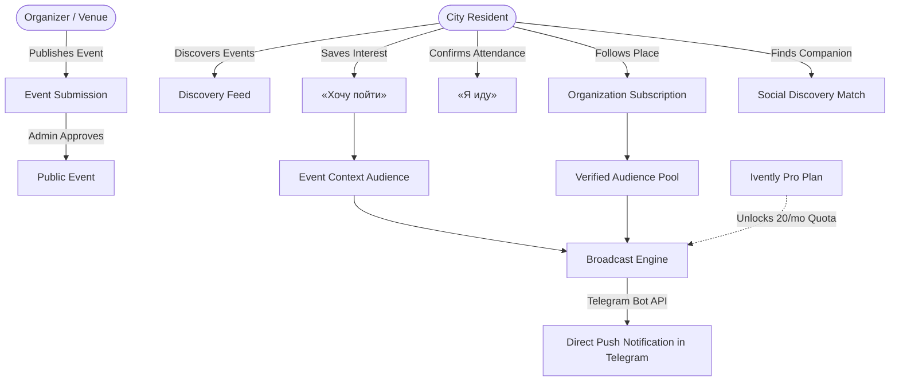
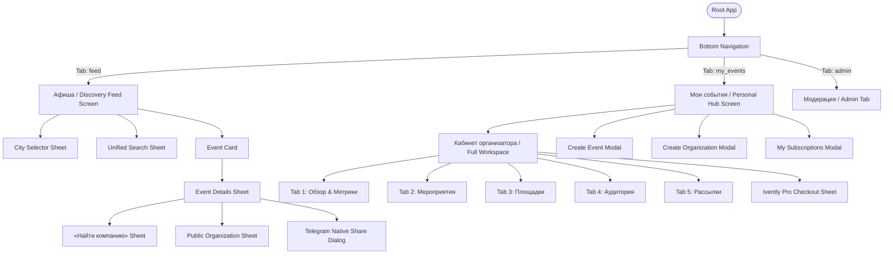
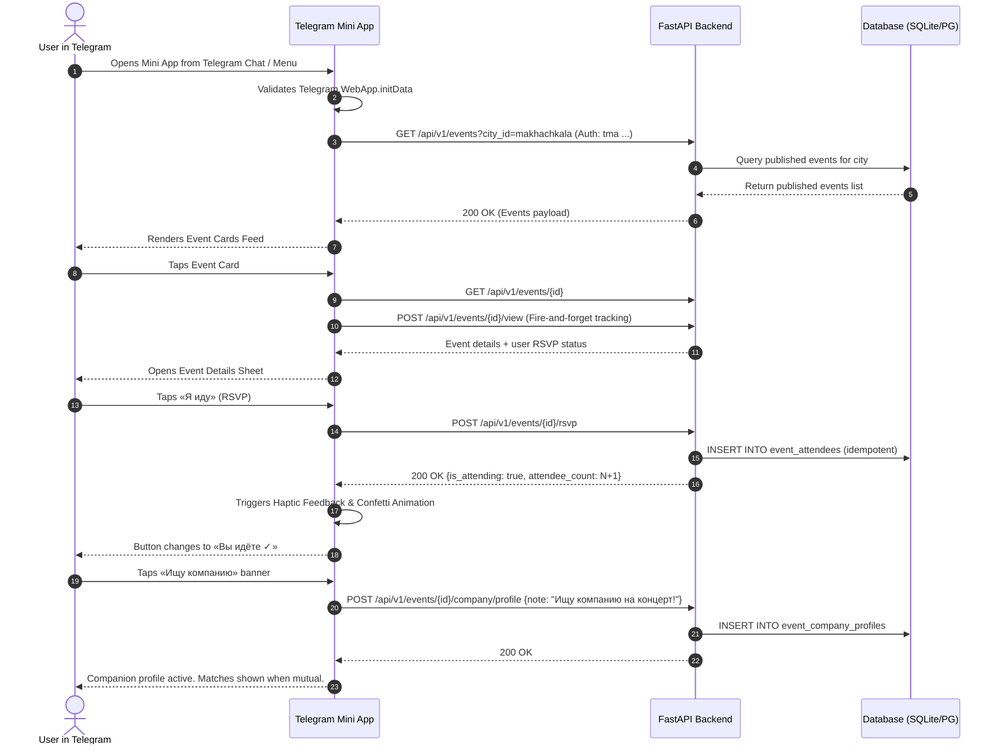
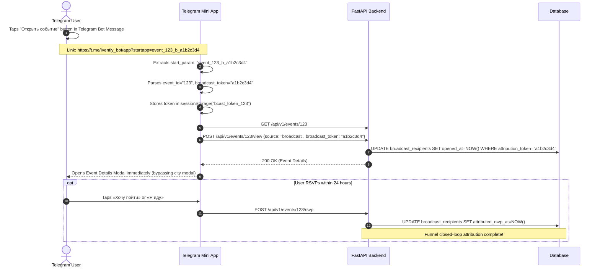
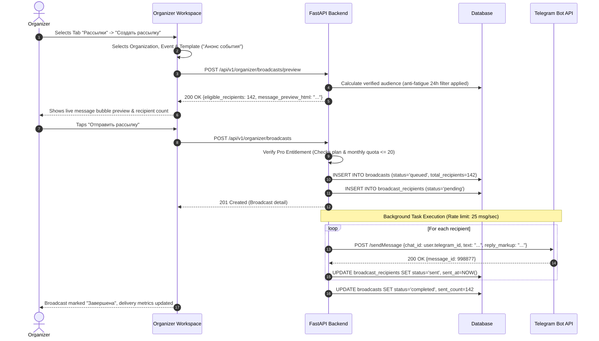
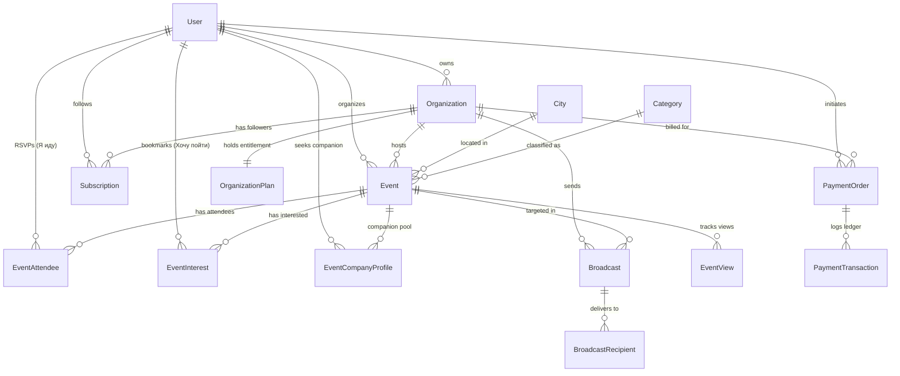
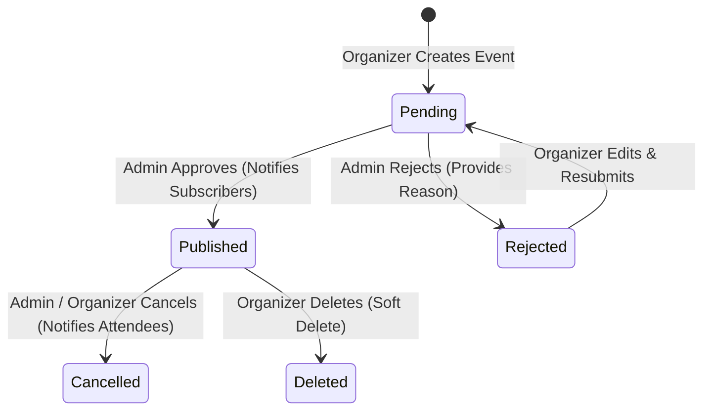

# IVENTLY — PRODUCT & ENGINEERING HANDOFF
## Comprehensive Read-Only Audit & System Knowledge Transfer Document

> **Document Type:** Production Architecture Reference & Engineering Handoff  
> **Status:** READ-ONLY SYSTEM AUDIT — FACT-CHECKED & VERIFIED  
> **Audience:** Successor AI Agent / Incoming Product Designer & Visual Design Engineer  
> **Repository:** Ivently (`evently`)  
> **Target Release Context:** Deployed Production System (`iventlyapp.ru` / Selectel / Caddy / FastAPI / SQLite WAL / Postgres / React 19)  
> **Audit Date:** October 2026  
> **Classification Standard:**  
> - **[A. VERIFIED IMPLEMENTATION]:** Confirmed directly in source code, database models, schemas, or passing test suites.  
> - **[B. DOCUMENTED INTENT]:** Documented in architectural specifications (`docs/d1`-`d6`) but partially active or awaiting full deployment.  
> - **[C. INFERRED BEHAVIOR]:** Highly plausible system behavior based on architectural patterns, requiring runtime verification.  
> - **[D. UNKNOWN OR UNVERIFIED]:** Elements not safely observable or unconfigured in the current environment.

---

## TABLE OF CONTENTS

1. [Executive Summary](#1-executive-summary)
2. [Product Overview & Value Proposition](#2-product-overview--value-proposition)
3. [Verified Feature Inventory](#3-verified-feature-inventory)
4. [Complete Screen & Modal Inventory](#4-complete-screen--modal-inventory)
5. [User Roles & Permissions Matrix](#5-user-roles--permissions-matrix)
6. [End-to-End User Journeys](#6-end-to-end-user-journeys)
7. [Frontend Architecture & Component System](#7-frontend-architecture--component-system)
8. [Backend Architecture & Services Layer](#8-backend-architecture--services-layer)
9. [Database Models & Entity Relationships](#9-database-models--entity-relationships)
10. [Authentication & Authorization (Telegram HMAC-SHA256)](#10-authentication--authorization-telegram-hmac-sha256)
11. [API Contracts & Backward-Compatibility Requirements](#11-api-contracts--backward-compatibility-requirements)
12. [Organizer Workspace & Broadcast Engine Deep Dive](#12-organizer-workspace--broadcast-engine-deep-dive)
13. [Event Lifecycle & Attendance Dual-State Architecture](#13-event-lifecycle--attendance-dual-state-architecture)
14. [External Integrations & Third-Party Services](#14-external-integrations--third-party-services)
15. [Tests & Verification Status](#15-tests--verification-status)
16. [Deployment & Infrastructure Architecture](#16-deployment--infrastructure-architecture)
17. [Established Product Decisions & Architectural Constraints](#17-established-product-decisions--architectural-constraints)
18. [Future Content & Expansion Readiness (Aggregators, Yandex Afisha)](#18-future-content--expansion-readiness-aggregators-yandex-afisha)
19. [Visual Redesign Safe Integration Map](#19-visual-redesign-safe-integration-map)
20. [Known Bugs, Technical Debt, and Gaps](#20-known-bugs-technical-debt-and-gaps)
21. [Product Glossary](#21-product-glossary)
22. [Priority File Reading List for Successor Agent](#22-priority-file-reading-list-for-successor-agent)

---

## 1. EXECUTIVE SUMMARY

**Ivently** is a fully functioning, deployed Telegram-first event discovery and community engagement platform operating inside Telegram as a WebApp / Mini App (TMA). It solves the urban event discovery problem by combining a high-performance event feed with organizer audience-building tools, companion finding («Найти компанию»), and targeted Telegram broadcast campaigns.

### Key Audit Findings:
1. **Architecture:** The application is built as a clean, decoupled monolith:
   - **Backend:** Python 3.13 + FastAPI + SQLAlchemy 2.0 Async + Pydantic v2 + SQLite WAL (local/dev) or PostgreSQL 16 (production).
   - **Frontend:** React 19.2 + TypeScript + Vite 8 + Tailwind CSS v4 + Lucide React icons.
   - **Proxy/Ingress:** Caddy 2 with automatic HTTPS TLS, gzip/zstd, and immutable caching for hashed assets and uploads.
2. **Current Production State:** The backend is deployed on a dedicated VPS (Selectel, Ubuntu 24.04, Docker Compose) serving the domain `iventlyapp.ru`, with Telegram webhook or long-polling update ingestion.
3. **Maturity & Stability:** The platform contains over 41 automated test suites in `tests/`, covering HMAC cryptographic authentication, full event lifecycle, organization ownership, audience deduplication, broadcast anti-fatigue algorithms, Pro entitlement limits, and YooKassa payment reconciliation.
4. **Mission of Successor Agent:** The business logic, state machines, API routes, database schemas, and permission rules are **stable, tested, and locked**. The purpose of the successor project is to build a modern visual presentation layer (**Liquid Glass UI**) in an isolated workspace without modifying or breaking any underlying business rules or backend endpoints.

---

## 2. PRODUCT OVERVIEW & VALUE PROPOSITION

### 2.1 The Problem It Solves
- **For Regular City Residents:**
  - Finding what to do tonight or this weekend in Russian cities (e.g. Makhachkala, Moscow, Saint Petersburg, Kazan) is fragmented across channels, chats, and websites.
  - Going alone can feel awkward. Ivently provides a built-in, privacy-preserving social discovery layer («Найти компанию») allowing users to find companions for specific events without broadcasting their private identity.
- **For Event Organizers, Venues, and Brands:**
  - Posting in Telegram channels suffers from algorithmic decay and low view rates.
  - Traditional ticketing platforms charge hefty fees and don't help organizers build a direct, recurring relationship with attendees.
  - Ivently allows organizers to build an organic subscriber base, track conversion funnels (views $\rightarrow$ interest $\rightarrow$ RSVP), and send direct, targeted Telegram broadcast notifications to subscribed users.

### 2.2 Core Business Model & Monetization [A. VERIFIED IMPLEMENTATION]
Ivently operates on a **Freemium model centered around Organization accounts**:
- **Free Core (100% Free Forever):**
  - Event discovery, search, filtering, and social companion matching.
  - Unlimited event creation and editing by organizers.
  - Organization profile management and organic subscriber collection.
  - Transactional operational notifications (event date/venue changes, cancellation alerts, moderation feedback) are completely free.
- **Ivently Pro (Commercial Monetization):**
  - Cost: 499 RUB / 30 days (one-time purchase via YooKassa hosted checkout).
  - Unlocks **marketing broadcasts** (up to 20 campaigns/month) to organization subscribers or users who expressed interest.
  - Unlocks advanced audience growth analytics and conversion funnel metrics.
  - Future Pro roadmap features: CRM export, audience segmentation, priority catalog placement, verified badge.



---

## 3. VERIFIED FEATURE INVENTORY

The table below catalogs every product feature, categorizing whether it is fully implemented in code, documented as intent, or planned.

| Feature Area | Specific Capability | Classification | Grounded Source Reference |
| :--- | :--- | :--- | :--- |
| **Discovery Feed** | City selection (Makhachkala, Moscow, SPb, Kazan, etc.) | **A. VERIFIED IMPLEMENTATION** | `backend/app/api/v1/cities.py`, `frontend/src/components/CityModal.tsx` |
| **Discovery Feed** | Category filtering (Concerts, Parties, Sport, Education, Business, Exhibitions, Other) | **A. VERIFIED IMPLEMENTATION** | `backend/app/models/category.py`, `frontend/src/components/FilterBar.tsx` |
| **Discovery Feed** | Date filtering (`all`, `today`, `tomorrow`, `weekend`) with city timezone handling | **A. VERIFIED IMPLEMENTATION** | `backend/app/services/event_service.py` (`list_published_events`) |
| **Discovery Feed** | Multi-entity Unified Search (Events, Organizations, Venues) | **A. VERIFIED IMPLEMENTATION** | `backend/app/services/discovery_service.py`, `DiscoveryModal.tsx` |
| **Discovery Feed** | Event view tracking with 2-hour deduplication and author exclusion | **A. VERIFIED IMPLEMENTATION** | `backend/app/services/event_service.py` (`record_event_view`) |
| **Event Details** | Full event display (cover, date/time, price/free, venue, organizer badge) | **A. VERIFIED IMPLEMENTATION** | `frontend/src/components/EventDetailsModal.tsx` |
| **Event Details** | Native Telegram Sharing via `savePreparedInlineMessage` (Telegram 8.0+) | **A. VERIFIED IMPLEMENTATION** | `backend/app/api/v1/events.py#L317`, `telegram.ts#L365` |
| **Attendance** | Confirmed RSVP («Я иду») — idempotent toggle | **A. VERIFIED IMPLEMENTATION** | `backend/app/models/attendee.py`, `backend/app/api/v1/events.py#L145` |
| **Attendance** | Bookmark / Interest («Хочу пойти») — idempotent toggle | **A. VERIFIED IMPLEMENTATION** | `backend/app/models/interest.py`, `backend/app/api/v1/events.py#L193` |
| **Social Matching** | «Найти компанию» companion search with mutual request auto-matching | **A. VERIFIED IMPLEMENTATION** | `backend/app/models/company.py`, `EventCompanyModal.tsx` |
| **Personal Hub** | Consolidated Personal Hub (`/api/v1/users/me/hub`) returning 5 lists in <80ms | **A. VERIFIED IMPLEMENTATION** | `backend/app/api/v1/users.py#L99`, `OrganizerTab.tsx` |
| **Personal Hub** | Organization Subscriptions list with unsubscribe control | **A. VERIFIED IMPLEMENTATION** | `frontend/src/components/MySubscriptionsModal.tsx` |
| **Creation** | Event creation with media upload (magic bytes validation, max 5MB) | **A. VERIFIED IMPLEMENTATION** | `backend/app/services/storage_service.py`, `CreateEventModal.tsx` |
| **Creation** | Event moderation queue (status `pending` upon creation) | **A. VERIFIED IMPLEMENTATION** | `backend/app/services/moderation_service.py`, `AdminTab.tsx` |
| **Organizations** | Organization creation, slug generation, profile editing, and deletion | **A. VERIFIED IMPLEMENTATION** | `backend/app/services/organization_service.py`, `CreateOrganizationModal.tsx` |
| **Organizations** | Public organization profiles with subscriber count and event lists | **A. VERIFIED IMPLEMENTATION** | `frontend/src/components/OrganizationModal.tsx` |
| **Workspace** | Organizer Workspace (Overview, Events, Organizations, Audience, Broadcasts) | **A. VERIFIED IMPLEMENTATION** | `frontend/src/components/OrganizerWorkspace.tsx` (143 KB) |
| **Audience** | Verified Audience calculation (subscribers, unique reach, 7d/30d growth) | **A. VERIFIED IMPLEMENTATION** | `backend/app/services/audience_service.py` |
| **Broadcasts** | Targeting: Organization subscribers vs Event-interested users | **A. VERIFIED IMPLEMENTATION** | `backend/app/services/broadcast_service.py#L110` |
| **Broadcasts** | 24-hour marketing anti-fatigue rule | **A. VERIFIED IMPLEMENTATION** | `backend/app/services/broadcast_service.py#L123` |
| **Broadcasts** | Attribution token generation & closed-loop funnel analytics | **A. VERIFIED IMPLEMENTATION** | `backend/app/models/broadcast.py#L70`, `App.tsx#L205` |
| **Pro Entitlements** | Entitlement Engine with multi-organization plan isolation | **A. VERIFIED IMPLEMENTATION** | `backend/app/services/entitlement_service.py` |
| **Payments** | YooKassa hosted checkout for one-time Pro purchase (499 RUB / 30 days) | **A. VERIFIED IMPLEMENTATION** | `backend/app/services/payment_service.py`, `yookassa.py` |
| **Payments** | Self-employed manual receipt registration (`POST /admin/payments/{id}/receipt`) | **A. VERIFIED IMPLEMENTATION** | `backend/app/api/v1/payments.py#L135` |
| **Telegram Bot** | Inline query handler (`@Ivently_bot <query>`) returning rich event results | **A. VERIFIED IMPLEMENTATION** | `backend/app/services/telegram_bot.py`, `parser_service.py` |
| **Telegram Bot** | Dual update delivery: Webhook OR Zero-latency Long Polling | **A. VERIFIED IMPLEMENTATION** | `backend/app/main.py#L51-149`, `telegram.py` |
| **Telegram Bot** | Scheduled automated event reminders (same-day morning / 2h before) | **A. VERIFIED IMPLEMENTATION** | `backend/app/services/reminder_service.py`, `main.py#L151` |
| **Future Readiness**| External event sourcing (`source_type`, `source_name`, `external_id`, `source_url`)| **A. VERIFIED IMPLEMENTATION** | `backend/app/models/event.py#L41-45` (Schema exists, sync job planned) |
| **Future Readiness**| Automated receipt generation via FNS «Мой налог» API | **B. DOCUMENTED INTENT** | `docs/d6.0.2-merchant-self-employed-receipts.md` |
| **Future Readiness**| Recurring card subscriptions with auto-renewal | **B. DOCUMENTED INTENT** | `docs/d6-pro-payments-architecture-audit.md` (Deferred to D6.2+) |

---

## 4. COMPLETE SCREEN & MODAL INVENTORY

The user interface is an adaptive Single Page Application (SPA) designed exclusively for the Telegram mobile viewport ($360\text{px} - 430\text{px}$ width).



### 4.1 Screen 1: Event Discovery Feed («Афиша»)
- **Component File:** [App.tsx](file:///C:/Users/yusup/.gemini/antigravity/scratch/evently/frontend/src/App.tsx), [Header.tsx](file:///C:/Users/yusup/.gemini/antigravity/scratch/evently/frontend/src/components/Header.tsx), [FilterBar.tsx](file:///C:/Users/yusup/.gemini/antigravity/scratch/evently/frontend/src/components/FilterBar.tsx), [EventCard.tsx](file:///C:/Users/yusup/.gemini/antigravity/scratch/evently/frontend/src/components/EventCard.tsx).
- **Data Source:** `GET /api/v1/events?city_id=...&category_id=...&date_filter=...&limit=50&offset=0`.
- **UI Elements:**
  - **Header:** Brand icon with subtle glow, City Selector pill button (`MapPin` + City Name), Search icon (`Search`).
  - **Category Pills:** Horizontally scrollable list of categories (Concerts, Parties, Sport, Education, Business, Exhibitions, Other) with active indicator.
  - **Date Segmented Control:** Smooth animated sliding pill (`all` — Все, `today` — Сегодня, `tomorrow` — Завтра, `weekend` — Выходные).
  - **Feed Grid:** Vertically scrollable list of `EventCard` components.
  - **Empty States:** Neutral dark card with icon, friendly copy («Событий на эти даты пока нет»), and a reset filters button.
  - **Loading Skeleton:** Shimmer cards matching event card geometry.

### 4.2 Modal: City Selector («Выбор города»)
- **Component File:** [CityModal.tsx](file:///C:/Users/yusup/.gemini/antigravity/scratch/evently/frontend/src/components/CityModal.tsx).
- **Data Source:** `GET /api/v1/cities` (pre-seeded with 15+ Russian cities: Makhachkala, Kaspiysk, Derbent, Moscow, Saint Petersburg, Kazan, etc.).
- **Behavior:**
  - Opens automatically on first launch if no city is stored in `localStorage('evently_selected_city_id')`.
  - Selecting a city stores the ID in `localStorage`, updates user preference on backend if authenticated, and instantly triggers a feed reload.

### 4.3 Modal: Unified Search & Discovery («Поиск»)
- **Component File:** [DiscoveryModal.tsx](file:///C:/Users/yusup/.gemini/antigravity/scratch/evently/frontend/src/components/DiscoveryModal.tsx).
- **Data Source:** `GET /api/v1/discovery/search?q=...&city_id=...`.
- **Behavior:**
  - Multi-entity live search input with debouncing and instant clear button.
  - Displays results grouped into three distinct sections:
    1. **События (Events):** Compact cards with date, venue, and status badges.
    2. **Организации (Organizations):** Avatars, subscriber count, verified checkmark.
    3. **Площадки (Venues):** Physical addresses and associated event count.

### 4.4 Sheet: Event Details («Детали события»)
- **Component File:** [EventDetailsModal.tsx](file:///C:/Users/yusup/.gemini/antigravity/scratch/evently/frontend/src/components/EventDetailsModal.tsx).
- **Data Source:** `GET /api/v1/events/{event_id}`.
- **UI & Controls:**
  - **Hero Media:** High-resolution cover image or category fallback with dark gradient scrim.
  - **Title & Metadata:** Title, Start date/time (localized in Russian), Venue name, Full address.
  - **Price Badge:** «Бесплатно» (green accent) or formatted currency (e.g. «1 500 ₽»).
  - **Description:** Formatted text with line-break support.
  - **Organizer Info Card:** Organization avatar, name, and «Подписаться» (Follow) button.
  - **Social Companion Banner («Найти компанию»):** Count of people looking for a companion with entry point to companion matching.
  - **Action Dock (Bottom Sticky Bar):**
    - **«Я иду» (RSVP):** Primary toggle button. Triggers haptic success and confetti micro-animation.
    - **«Хочу пойти» (Bookmark/Interest):** Secondary toggle button with bookmark icon.
    - **«Поделиться» (Share):** Calls Telegram Bot API `savePreparedInlineMessage` and opens Telegram's native chat picker.

### 4.5 Sheet: Social Companion Matching («Найти компанию»)
- **Component File:** [EventCompanyModal.tsx](file:///C:/Users/yusup/.gemini/antigravity/scratch/evently/frontend/src/components/EventCompanyModal.tsx).
- **Data Source:** `GET /api/v1/events/{id}/company/status`, `GET /api/v1/events/{id}/company/members`.
- **Privacy Design:**
  - Users must explicitly opt-in with a short note (up to 140 chars). Marking «Я иду» does **not** expose the user.
  - Telegram handles and phone numbers are **never** displayed to third parties.
  - When two users send mutual companion requests, an auto-match is triggered and both are notified.

### 4.6 Screen 2: Personal Hub («Мои события»)
- **Component File:** [OrganizerTab.tsx](file:///C:/Users/yusup/.gemini/antigravity/scratch/evently/frontend/src/components/OrganizerTab.tsx).
- **Data Source:** `GET /api/v1/users/me/hub`.
- **UI Structure:**
  - **Segmented Control:** «Я иду» (Attending) vs «Хочу пойти» (Interested).
  - **Personal Event Cards:** Cards showing user's saved events with date countdown and quick removal actions.
  - **«Мои подписки» Entry Point:** Opens sheet listing organizations followed by user.
  - **«Кабинет организатора» Banner:** Distinct hero card inviting user to create an event or manage existing venues/organizations.

### 4.7 Full Screen Workspace: Organizer Workspace («Кабинет организатора»)
- **Component File:** [OrganizerWorkspace.tsx](file:///C:/Users/yusup/.gemini/antigravity/scratch/evently/frontend/src/components/OrganizerWorkspace.tsx).
- **Data Sources:** `/api/v1/organizer/events`, `/api/v1/organizer/audience`, `/api/v1/organizer/insights`, `/api/v1/organizer/broadcasts`, `/api/v1/organizer/entitlements`.
- **5 Comprehensive Tabs:**
  1. **«Обзор» (Overview):** Summary KPI cards (Subscribers, Total Event Views, Total RSVPs, Broadcast Reach), Pro status banner, quick action buttons («Создать событие», «Запустить рассылку»).
  2. **«Мероприятия» (Events):** Filterable event manager (`upcoming`, `pending`, `past`) with status badges, edit controls, and deletion dialogs.
  3. **«Площадки» (Organizations):** Profiles owned by organizer, address, categories, and profile editor.
  4. **«Аудитория» (Audience):** Verified audience metrics: total followers, 7-day and 30-day organic growth, unique event reach, engagement rate.
  5. **«Рассылки» (Broadcasts):** Campaign creator and delivery log. Allows composing messages, selecting audience targets, previewing Telegram layout, and viewing delivered/opened/RSVP attribution stats.

### 4.8 Modals: Creation & Management
- **Create Event Modal ([CreateEventModal.tsx](file:///C:/Users/yusup/.gemini/antigravity/scratch/evently/frontend/src/components/CreateEventModal.tsx)):** Form with image upload, title, category, start date/time, venue, address, price, and organization assignment.
- **Create Organization Modal ([CreateOrganizationModal.tsx](file:///C:/Users/yusup/.gemini/antigravity/scratch/evently/frontend/src/components/CreateOrganizationModal.tsx)):** Name, auto-generated slug, category, city, address, social link, and avatar upload.
- **Admin Moderation Tab ([AdminTab.tsx](file:///C:/Users/yusup/.gemini/antigravity/scratch/evently/frontend/src/components/AdminTab.tsx)):** Admin-only queue with filters (`pending`, `published`, `rejected`), event approval, rejection reason modal, and plan toggle tools for development.

---

## 5. USER ROLES & PERMISSIONS MATRIX

Access control is enforced at both the FastAPI dependency layer (`app.api.deps`) and database query filters.

| Capability / Action | Anonymous / Guest | Authenticated User | Event Organizer | Organization Owner | Platform Admin |
| :--- | :---: | :---: | :---: | :---: | :---: |
| Browse public feed & filter events | Yes | Yes | Yes | Yes | Yes |
| View public event details | Yes | Yes | Yes | Yes | Yes |
| Search events, orgs, venues | Yes | Yes | Yes | Yes | Yes |
| Confirm RSVP («Я иду») | No (401) | Yes | Yes | Yes | Yes |
| Mark interest («Хочу пойти») | No (401) | Yes | Yes | Yes | Yes |
| Opt-in to companion search | No (401) | Yes | Yes | Yes | Yes |
| Follow / Unfollow organization | No (401) | Yes | Yes | Yes | Yes |
| Create event (enters `pending`) | No (401) | Yes | Yes | Yes | Yes |
| Edit own event | No (401) | No (403) | Yes (Own only) | Yes (Own only) | Yes |
| Delete own event (soft-delete) | No (401) | No (403) | Yes (Own only) | Yes (Own only) | Yes |
| Create organization | No (401) | Yes | Yes | Yes | Yes |
| Edit organization profile | No (401) | No (403) | No (403) | Yes (Owner only) | Yes |
| View Organizer Workspace | No (401) | Yes (Empty state) | Yes | Yes | Yes |
| Send Broadcast (Requires Pro) | No (401) | No (403) | Pro-only (403) | Pro-only (403) | Yes |
| Purchase Ivently Pro | No (401) | No (400 - No org) | Yes | Yes | Yes |
| Access Admin Tab (`/admin`) | No (401) | No (403) | No (403) | No (403) | Yes |
| Approve / Reject events in queue | No (401) | No (403) | No (403) | No (403) | Yes |
| Register self-employed receipts | No (401) | No (403) | No (403) | No (403) | Yes |

---

## 6. END-TO-END USER JOURNEYS

### 6.1 Journey 1: Event Discovery $\rightarrow$ Attendance $\rightarrow$ Companion Matching



### 6.2 Journey 2: Deep Link Activation (`event_<id>_b_<token>`)



### 6.3 Journey 3: Organizer Broadcast Campaign Lifecycle



---

## 7. FRONTEND ARCHITECTURE & COMPONENT SYSTEM

### 7.1 Framework & Core Dependencies
- **Framework:** React 19.2.8 (`react`, `react-dom`).
- **Build Tool:** Vite 8.3.0 with `@vitejs/plugin-react` 6.1.1.
- **Language:** TypeScript 6.0.2 (`tsc -b` for strict typechecking).
- **CSS Engine:** Tailwind CSS v4.3.3 (`@tailwindcss/vite`).
- **Icons:** Lucide React 1.48.0.
- **Linter:** Oxlint 1.81.0 (ultra-fast Rust-based linter).

### 7.2 Source Directory Structure
```
frontend/src/
├── App.tsx                     # Master container, modal coordinator, router, deep link dispatcher
├── main.tsx                    # React DOM root entry point
├── index.css                   # Global Tailwind v4 styles, specular tokens, animation keyframes
├── types/
│   └── index.ts                # Unified domain TypeScript interfaces and API schemas
├── services/
│   ├── api.ts                  # Fetch API client, retry engine, URL builders, error parsers
│   └── telegram.ts             # Telegram WebApp SDK facade, haptics, BackButton, start_param
└── components/
    ├── Header.tsx              # Brand logo, City selector trigger, Search trigger
    ├── FilterBar.tsx           # Category horizontal pills
    ├── AnimatedSegmentedControl.tsx # Floating pill slider for Date & Status toggles
    ├── EventCard.tsx           # Primary feed card with cover, badges, price, and venue
    ├── EventDetailsModal.tsx   # Comprehensive event detail sheet
    ├── CityModal.tsx           # City selection bottom sheet
    ├── DiscoveryModal.tsx      # Multi-entity live search bottom sheet
    ├── EventCompanyModal.tsx   # Social companion finder («Найти компанию»)
    ├── Navigation.tsx          # Fixed bottom navigation bar (feed, my_events, admin)
    ├── OrganizerTab.tsx        # Personal Hub («Мои события» attending/interested lists)
    ├── OrganizerWorkspace.tsx  # Full Organizer Command Center (Overview, Events, Orgs, Audience, Broadcasts)
    ├── CreateEventModal.tsx    # Event creation and editing modal
    ├── CreateOrganizationModal.tsx # Organization profile creation and editing modal
    ├── OrganizationModal.tsx   # Public organization profile sheet
    ├── MySubscriptionsModal.tsx# List of organizations followed by the user
    ├── AdminTab.tsx            # Moderation queue and developer test tools
    ├── SafeAvatar.tsx          # Resilient avatar with letter fallback on load error
    └── SafeImage.tsx           # Resilient image with category placeholder on load error
```

### 7.3 Shared vs. Screen-Specific Components
- **Global Shared Components:**
  - `Header.tsx`: Present on feed and personal hub; renders city selector and search button.
  - `Navigation.tsx`: Fixed bottom dock; coordinates tabs and triggers light haptics.
  - `SafeAvatar.tsx` & `SafeImage.tsx`: Prevent broken image icons across all modals and cards.
  - `AnimatedSegmentedControl.tsx`: Reusable layout component using CSS transforms for smooth sliding selection indicators.
- **Screen-Specific Components:**
  - `OrganizerWorkspace.tsx`: Self-contained 143 KB workspace containing its own sub-tab navigation, chart widgets, broadcast composer, and YooKassa payment trigger.

### 7.4 Styling Tokens & Liquid Glass Aesthetics
The application uses a refined dark editorial liquid glass palette configured in `index.css`:
- **Backgrounds:** Obsidian Dark (`#050507`), Surface Charcoal (`#121216`), Floating Glass (`rgba(255, 255, 255, 0.04)` to `0.08`).
- **Specular Highlights:** Top-edge border sheen (`border-t border-white/14` or `border-white/10`).
- **Typography:** Zinc hierarchy (`text-zinc-100` headings, `text-zinc-400` secondary metadata, `text-zinc-500` captions).
- **Accents:** Electric Indigo (`#6366F1`) and Violet (`#8B5CF6`) for primary interactive states; Emerald (`#10B981`) for free events and attendance confirmation.

---

## 8. BACKEND ARCHITECTURE & SERVICES LAYER

### 8.1 Framework & Core Technologies
- **Framework:** FastAPI (Python 3.13) with ASGI asynchronous request handling.
- **ORM & Database Client:** SQLAlchemy 2.0 (Async) + `aiosqlite` (local) / `asyncpg` (production).
- **Validation:** Pydantic v2 schemas for all request payloads and response contracts.
- **HTTP Client:** HTTPX (async client with connection pooling and timeouts).

### 8.2 Backend Directory Structure
```
backend/app/
├── main.py                     # Lifespan startup, static mounts, background reminder loop, router
├── config.py                   # Pydantic Settings, environment variables, validation
├── database.py                 # Async engine, SQLite WAL pragmas, sessionmaker, idempotent migrations
├── api/
│   ├── deps.py                 # Authentication dependencies (get_current_user, require_admin)
│   └── v1/
│       ├── router.py           # Master API router prefixing /api/v1
│       ├── events.py           # Discovery feed, event details, RSVP, interest, create, edit, delete
│       ├── organizer.py        # Workspace overview, audience metrics, insights, entitlements, broadcasts
│       ├── organizations.py    # Org creation, profile, subscription toggle, deletion
│       ├── discovery.py        # Unified multi-entity search endpoint
│       ├── company.py          # Social companion discovery profiles, requests, and matches
│       ├── payments.py         # Pro purchase order creation, polling, YooKassa webhook, admin receipts
│       ├── admin.py            # Moderation queue, event approval/rejection, plan management
│       ├── telegram.py         # Inbound Telegram webhook dispatcher, inline queries, /start handler
│       ├── users.py            # Profile, subscription list, personal events, consolidated /hub
│       ├── cities.py           # City list and user default city persistence
│       ├── categories.py       # Event categories list
│       └── locations.py        # Venue and place suggestions
├── models/                     # SQLAlchemy declarative models (15 entities)
├── schemas/                    # Pydantic response and request models
├── services/                   # Business logic layer (Broadcast, Event, Payment, Telegram, Storage)
└── seeds/                      # Demo seed data (Russian cities, verified venues, realistic events)
```

### 8.3 Services Architecture
All controllers in `backend/app/api/v1/` are thin handlers that delegate business operations to dedicated services:
1. `broadcast_service.py` (50 KB): Audience filtering, message formatting, HTML escaping, rate-limited dispatch, and token generation.
2. `event_service.py` (45 KB): Filtering by timezone, attendance dual-state logic, and view counting.
3. `company_service.py` (34 KB): Companion matching, mutual request detection, and privacy controls.
4. `payment_service.py` (25 KB): Order idempotency, YooKassa checkout initiation, webhook verification, and atomic plan extension.
5. `entitlement_service.py` (14 KB): Centralized registry of organization plans and capability checks.
6. `storage_service.py` (12 KB): Magic bytes verification, persistent disk / S3 uploads, and CDN URL formatting.
7. `notification_service.py` (24 KB): Transactional Telegram push messages with photo + caption fallback.
8. `reminder_service.py`: Periodic background job sending automated morning-of and 2-hour-before event reminders.

---

## 9. DATABASE MODELS & ENTITY RELATIONSHIPS

The database uses 15 interconnected relational models defined in `backend/app/models/`.



### 9.1 Core Entity Specifications

#### `User` (`users`)
- `id`: Integer primary key.
- `telegram_id`: BigInteger (unique, indexed).
- `username`: String (nullable).
- `first_name`, `last_name`: String (nullable).
- `avatar_url`: String (nullable).
- `default_city_id`: ForeignKey to `cities.id`.

#### `Event` (`events`)
- `id`: String(36) UUID primary key.
- `title`: String(255), `description`: Text.
- `cover_image_url`: String(1024) (nullable).
- `category_id`: ForeignKey to `categories.id`.
- `city_id`: ForeignKey to `cities.id`.
- `start_at`: DateTime (UTC, indexed).
- `venue_name`: String(255), `address`: String(255).
- `price_amount`: Float (nullable, None = Free), `price_currency`: String(10).
- `status`: String (`pending`, `published`, `rejected`, `cancelled`, `deleted`).
- `organizer_user_id`: ForeignKey to `users.id`.
- `organization_id`: ForeignKey to `organizations.id` (nullable).
- `source_type`: String (`user` vs `external`).
- `source_name`, `external_id`, `source_url`, `last_synced_at`: External aggregation readiness fields.

#### `EventAttendee` (`event_attendees`)
- `event_id`: ForeignKey to `events.id` (composite primary key).
- `user_id`: ForeignKey to `users.id` (composite primary key).
- `created_at`: DateTime.
- *Semantics:* Represents confirmed attendance («Я иду»).

#### `EventInterest` (`event_interests`)
- `id`: String(36) UUID primary key.
- `event_id`: ForeignKey to `events.id`, `user_id`: ForeignKey to `users.id`.
- Unique constraint on `(event_id, user_id)`.
- *Semantics:* Represents bookmarking or soft interest («Хочу пойти»).

#### `Organization` (`organizations`)
- `id`: String(36) UUID primary key.
- `owner_user_id`: ForeignKey to `users.id`.
- `name`: String(255), `slug`: String(255) (unique).
- `category`: String(50), `city_id`: ForeignKey to `cities.id`.
- `address`, `avatar_url`, `website`, `social_link`: String (nullable).
- `status`: String (`active`, `disabled`, `deleted`).
- `is_verified`: Boolean.

#### `OrganizationPlan` (`organization_plans`)
- `id`: String(36) UUID primary key.
- `organization_id`: ForeignKey to `organizations.id` (unique).
- `plan`: String (`free`, `pro`).
- `status`: String (`active`, `expired`, `cancelled`).
- `starts_at`: DateTime, `expires_at`: DateTime (nullable).

#### `Broadcast` (`broadcasts`)
- `id`: String(36) UUID primary key.
- `organization_id`: ForeignKey to `organizations.id`.
- `event_id`: ForeignKey to `events.id` (nullable).
- `target_type`: String (`organization_subscribers`, `event_interest`).
- `broadcast_type`: String (`marketing`, `transactional`).
- `template_key`: String (`event_announcement`, `event_update`, `custom_update`).
- `custom_text`: String(500) (nullable).
- `status`: String (`draft`, `queued`, `processing`, `completed`, `failed`).
- `attribution_token`: String(32) (unique, 16 hex chars).
- `total_recipients`, `sent_count`, `delivered_count`, `failed_count`, `blocked_count`: Integer counters.

#### `BroadcastRecipient` (`broadcast_recipients`)
- `id`: String(36) UUID primary key.
- `broadcast_id`: ForeignKey to `broadcasts.id`, `user_id`: ForeignKey to `users.id`.
- `status`: String (`pending`, `sending`, `sent`, `failed`, `blocked`).
- `sent_at`, `clicked_at`, `opened_at`, `attributed_interest_at`, `attributed_rsvp_at`: DateTime stamps.

#### `PaymentOrder` (`payment_orders`)
- `id`: String(36) UUID primary key.
- `organization_id`: ForeignKey to `organizations.id`, `user_id`: ForeignKey to `users.id`.
- `amount`: Float (499.0), `currency`: String ("RUB").
- `provider`: String ("yookassa"), `provider_payment_id`: String(100) (nullable, unique).
- `idempotency_key`: String(100) (unique).
- `status`: String (`pending`, `waiting_for_payment`, `succeeded`, `canceled`, `failed`).
- `customer_email`: String(255) (nullable), `confirmation_url`: String(1024).
- `paid_at`, `expires_at`: DateTime (nullable).
- `receipt_status`: String (`pending`, `issued`), `receipt_url`: String(1024).

---

## 10. AUTHENTICATION & AUTHORIZATION (TELEGRAM HMAC-SHA256)

### 10.1 Cryptographic Validation Protocol [A. VERIFIED IMPLEMENTATION]
Telegram Mini Apps authenticate requests using an encrypted query string provided by the Telegram client via `window.Telegram.WebApp.initData`.

```
Client Header:
Authorization: tma query_id=...&user={"id":123,...}&auth_date=1728567890&hash=3a8f...
```

The backend validates this data in `backend/app/services/auth_service.py` adhering strictly to Telegram's official specification:
1. Parse parameters as URL query string pairs.
2. Remove the `hash` field.
3. Sort remaining key-value pairs alphabetically and format as `key=value\n`.
4. Derive secret key: $\text{secret\_key} = \text{HMAC-SHA256}(\text{"WebAppData"}, \text{bot\_token})$.
5. Calculate expected hash: $\text{expected} = \text{HMAC-SHA256}(\text{secret\_key}, \text{data\_check\_string})$.
6. Perform constant-time verification: `hmac.compare_digest(expected, received_hash)`.
7. Freshness guard: verify `now - auth_date <= settings.AUTH_DATE_MAX_AGE_SECONDS` (default: 86,400s / 24h).
8. Parse user JSON payload and synchronize user record via `get_or_create_user(session, tg_user)`.

### 10.2 Security Boundaries for Visual Redesign
- **NEVER** mock or alter the `Authorization: tma <initData>` header generation in production.
- The visual redesign layer must **always** pass `telegram.getInitData()` into `api.ts`.
- In local web development outside Telegram, `telegram.ts` automatically falls back to `localStorage.getItem('evently_mock_init_data')`.

---

## 11. API CONTRACTS & BACKWARD-COMPATIBILITY REQUIREMENTS

The table below highlights critical API endpoints that the frontend consumes and must maintain without contract breakage.

| Endpoint | Method | Key Request Params / Body | Key Response Contract | Side Effects / Notes |
| :--- | :--- | :--- | :--- | :--- |
| `/api/v1/events` | `GET` | `city_id`, `category_id`, `date_filter`, `limit`, `offset` | `EventListResponse` (`events[]`, `total`, `city_id`) | Reads published events, joins attendee & interest counts |
| `/api/v1/events/{id}` | `GET` | None | `EventResponse` (includes `is_attending`, `is_interested`) | Public read; reflects user's personal RSVP if authenticated |
| `/api/v1/events/{id}/rsvp` | `POST` | None | `RSVPResponse` (`is_attending: true`, `attendee_count`) | Idempotent RSVP; removes existing `EventInterest` record |
| `/api/v1/events/{id}/rsvp` | `DELETE`| None | `RSVPResponse` (`is_attending: false`, `attendee_count`) | Idempotent cancel attendance |
| `/api/v1/events/{id}/interest` | `POST` | None | `EventInterestResponse` (`is_interested: true`) | Idempotent interest; removes existing `EventAttendee` record |
| `/api/v1/events/{id}/interest` | `DELETE`| None | `EventInterestResponse` (`is_interested: false`) | Idempotent cancel interest |
| `/api/v1/events/{id}/view` | `POST` | `{source: "...", broadcast_token: "..."}` | `EventViewResponse` (`recorded: bool`, `views_count`) | Deduplicated 2h view counter; closes broadcast attribution |
| `/api/v1/events/{id}/prepare-share`| `POST`| None | `{prepared_message_id: "...", expiration_date: int}` | Calls Telegram Bot API `savePreparedInlineMessage` |
| `/api/v1/users/me/hub` | `GET` | None | `UserHubResponse` (`attending[]`, `interested[]`, `orgs[]`) | Single lightweight query (<80ms) for Personal Hub |
| `/api/v1/organizations/{id}/subscribe`| `POST` | None | `SubscriptionStatusResponse` (`is_subscribed: true`) | Idempotent follow organization |
| `/api/v1/organizer/audience` | `GET` | `org_id` (optional) | `OrganizerAudienceResponse` (reach, subscribers, 7d/30d) | Real un-faked audience metrics |
| `/api/v1/organizer/broadcasts/preview`| `POST` | `{organization_id, target_type, template_key, text}` | `BroadcastPreviewResponse` (`eligible_recipients`, `preview_html`)| Dry-run audience calculation |
| `/api/v1/organizer/broadcasts` | `POST` | `BroadcastCreateRequest` | `BroadcastDetail` (`status: "queued"`, counters) | Verifies Pro plan; queues background message dispatch |
| `/api/v1/organizer/payments/pro` | `POST` | `{organization_id, customer_email}` | `PaymentOrderResponse` (`confirmation_url: "https://..."`) | Initiates YooKassa checkout |
| `/api/v1/discovery/search` | `GET` | `q`, `city_id` | `UnifiedDiscoveryResponse` (`events[]`, `organizations[]`, `venues[]`)| Consolidated multi-entity search |

---

## 12. ORGANIZER WORKSPACE & BROADCAST ENGINE DEEP DIVE

### 12.1 Audience Calculation & Strict Targeting Rules [A. VERIFIED IMPLEMENTATION]
The broadcast engine (`backend/app/services/broadcast_service.py`) calculates recipients deterministically using verified database records:
1. **Target Type: `organization_subscribers`:**
   - Queries `subscriptions` table for `organization_id == target_org_id` where `notifications_enabled == True`.
2. **Target Type: `event_interest`:**
   - Queries `event_interests` table for users who explicitly clicked «Хочу пойти» on a published event owned by the organization.
3. **Strictly Prohibited Audiences:**
   - The engine **explicitly rejects** broadcasting to raw event viewers, past un-subscribed attendees, or arbitrary user IDs.
4. **Anti-Fatigue Guardrail:**
   - Any user who received a marketing broadcast from **any** organization within the last 24 hours (`settings.BROADCAST_FATIGUE_HOURS`) is automatically excluded from subsequent marketing broadcasts.
   - Transactional event updates bypass this anti-fatigue rule.

### 12.2 Closed-Loop Funnel Attribution
Every broadcast generates a cryptographically secure 16-hex character token (`attribution_token`). All links in message buttons use the format:
`https://t.me/Ivently_bot/app?startapp=event_{event_id}_b_{attribution_token}`
When an attendee opens this link:
1. The Mini App records `opened_at` on the `broadcast_recipients` record.
2. If the user clicks «Хочу пойти» within 24h, `attributed_interest_at` is stamped.
3. If the user clicks «Я иду» within 24h, `attributed_rsvp_at` is stamped.
4. Organizers see the resulting conversion rate directly in their Broadcast History tab.

---

## 13. EVENT LIFECYCLE & ATTENDANCE DUAL-STATE ARCHITECTURE

### 13.1 Event Moderation Lifecycle States



- **Pending:** Event created by organizer; visible only to the creator and admin queue.
- **Published:** Visible in public city discovery feeds, search, and inline query results.
- **Rejected:** Organizer receives rejection explanation; can edit and resubmit.
- **Cancelled:** Removed from public discovery; attendees notified of cancellation.
- **Deleted:** Soft-deleted (`status = 'deleted'`); preserves historical analytics, RSVP records, and broadcast attribution.

### 13.2 Attendance Dual-State Machine («Я иду» vs «Хочу пойти»)
Ivently maintains a strict semantic distinction between two user intentions:
1. **«Я иду» (RSVP / Confirmed Attendance):**
   - Model: `EventAttendee` (`event_attendees`).
   - Represents a firm commitment to attend.
   - Triggers reminders (morning-of and 2-hour-before).
2. **«Хочу пойти» (Interest / Bookmark):**
   - Model: `EventInterest` (`event_interests`).
   - Represents a bookmark or soft interest.
   - Qualifies the user for event-specific organizer updates.

> **Crucial Invariant:** These states are mutually exclusive per event. Clicking «Я иду» automatically removes any existing «Хочу пойти» record for that user/event, and vice versa. Calling the active state's endpoint again safely toggles it off.

---

## 14. EXTERNAL INTEGRATIONS & THIRD-PARTY SERVICES

### 14.1 Telegram Bot API & WebApp SDK [A. VERIFIED IMPLEMENTATION]
- **SDK Methods Used:**
  - `ready()`, `expand()`: Initializes full-height viewport.
  - `HapticFeedback`: Used on tab switches (`light`), toggling RSVP (`success`), and errors.
  - `BackButton`: Synchronized with modal navigation stack.
  - `savePreparedInlineMessage`: Enables direct peer-to-peer event sharing inside Telegram.
- **Bot Handlers:**
  - `handle_inline_query`: Responds to `@Ivently_bot <query>` in any chat with formatted event cards.
  - `handle_private_message`: Responds to `/start` with welcome text and Mini App launch button.

### 14.2 YooKassa Hosted Checkout (D6.1) [A. VERIFIED IMPLEMENTATION]
- **Provider:** YooKassa API v3 via `backend/app/services/payment/yookassa.py`.
- **Checkout Flow:** Server calls YooKassa `/payments` with redirect confirmation URL $\rightarrow$ user completes payment on YooKassa $\rightarrow$ redirects back to `iventlyapp.ru/?payment_order_id=...` $\rightarrow$ server reconciles order status and extends `OrganizationPlan` by 30 days.
- **Self-Employed Receipts (422-FZ):** YooKassa does not automatically issue receipts for self-employed accounts. The admin registers official ФНС «Мой налог» receipts via `POST /admin/payments/{id}/receipt`.

### 14.3 TypeSafe AI [A. VERIFIED IMPLEMENTATION]
- Optional secondary content safety service in `backend/app/services/typesafe.py`.
- Completely non-blocking: if unconfigured or unreachable, deterministic fallback validation takes over with zero disruption.

---

## 15. TESTS & VERIFICATION STATUS

The repository features 41 comprehensive backend test suites in `tests/`:

| Test Suite File | Coverage Scope | Execution Status |
| :--- | :--- | :--- |
| `tests/test_auth.py` | HMAC-SHA256 signature verification, tampering, expiration | Inspected |
| `tests/test_events_and_rsvp.py` | Feed discovery, idempotent RSVP toggle, interest toggle | Inspected |
| `tests/test_event_lifecycle_and_sync.py`| Creation, moderation transitions, soft-deletion | Inspected |
| `tests/test_organizations_and_subscriptions.py`| Org profiles, slugs, follow/unfollow idempotency | Inspected |
| `tests/test_broadcasts.py` | Target audience calculation, template rendering, rates | Inspected |
| `tests/test_pro_entitlements.py` | Plan resolution, multi-org isolation, capability locks | Inspected |
| `tests/test_payments.py` | Order creation, idempotency keys, YooKassa webhook handling | Inspected |
| `tests/test_share_v2.py` | `savePreparedInlineMessage` bindings, deep-link formats | Inspected |
| `tests/test_company.py` | Social companion search, mutual request auto-matching | Inspected |
| `tests/test_telegram_bot.py` | Inline query parsing, /start reply generation | Inspected |

> **Audit Testing Note:** In the local host environment, global Python 3.13 has `pytest` 9.1.1 but lacks `pytest-asyncio` in global site-packages (tests run inside containerized environments or dedicated venvs). In accordance with the Read-Only Safety Protocol, no packages were installed during this audit.

---

## 16. DEPLOYMENT & INFRASTRUCTURE ARCHITECTURE

### 16.1 Production Environment (Selectel VPS) [A. VERIFIED IMPLEMENTATION]
- **Hosting:** Selectel VPS, Ubuntu 24.04 LTS.
- **Domain:** `iventlyapp.ru` (HTTPS managed by Caddy).
- **Orchestration:** Docker Compose (`docker-compose.yml`).
  - **Service 1 (`caddy`):** Caddy 2 Alpine reverse proxy handling TLS, HTTP/2, and static uploads serving.
  - **Service 2 (`app`):** FastAPI + Uvicorn monolith serving API routes and compiled SPA assets.
  - **Service 3 (`db`):** PostgreSQL 16 Alpine container with persistent storage at `/var/lib/ivently/postgres_data`.
- **Uploads Volume:** `/var/lib/ivently/uploads` mounted directly into Caddy and FastAPI.

### 16.2 Environment Variables Reference
The application configures the following environment variables (no secret values exposed):

| Variable Name | Required | Purpose & Default |
| :--- | :---: | :--- |
| `APP_NAME` | No | Application display title (Default: `Ivently`) |
| `APP_ENV` | Yes | Environment mode (`development`, `staging`, `production`) |
| `PORT`, `HOST` | No | Server binding parameters (Default: `8000`, `0.0.0.0`) |
| `PUBLIC_HOST` | Yes | Public hostname (e.g. `iventlyapp.ru`) |
| `DATABASE_URL` | Yes | SQLAlchemy async connection URI (`sqlite+aiosqlite:...` or `postgresql+asyncpg:...`) |
| `TELEGRAM_BOT_TOKEN` | Yes | Bot token issued by `@BotFather` |
| `TELEGRAM_BOT_USERNAME` | Yes | Bot username (Default: `Ivently_bot`) |
| `TELEGRAM_MINI_APP_URL` | Yes | Direct launch link (e.g. `https://t.me/Ivently_bot/app`) |
| `ADMIN_USER_IDS` | Yes | Comma-separated list of Telegram user IDs with admin privileges |
| `SECRET_KEY` | Yes | Cryptographic salt / secret key |
| `PAYMENTS_ENABLED` | No | Boolean flag enabling commercial YooKassa checkout |
| `PRO_MONTHLY_PRICE_RUB` | No | Monthly price for Pro plan (Default: `499.0`) |
| `YOOKASSA_SHOP_ID` | Conditional| YooKassa merchant identifier (required if payments enabled) |
| `YOOKASSA_SECRET_KEY` | Conditional| YooKassa API secret key |

---

## 17. ESTABLISHED PRODUCT DECISIONS & DESIGN CONSTRAINTS

The following product decisions have been finalized and must not be altered:
1. **Primary Navigation Structure:** Exactly two primary tabs for ordinary users: «Афиша» (Discovery Feed) and «Мои события» (Personal Hub). A third tab, «Модерация» (Admin), is displayed only if the user is in `ADMIN_USER_IDS`.
2. **Dedicated Workspace:** The Organizer Workspace is accessed from the Personal Hub, opening as a comprehensive full-screen command center rather than cluttering bottom navigation.
3. **Multi-Organization Isolation:** Plans, quotas, and broadcasts belong to the **Organization**, not the user account. A user owning multiple organizations maintains independent plans for each.
4. **Broadcast Fatigue Protection:** A hard 24-hour anti-fatigue rule prevents spamming Telegram users with marketing broadcasts across organizations.
5. **Privacy First in Social Matching:** The companion finder («Найти компанию») is an explicit, separate opt-in. An RSVP does not expose the user's profile to other attendees.

---

## 18. FUTURE CONTENT & EXPANSION READINESS (AGGREGATORS, YANDEX AFISHA)

The data model was deliberately architected in Sprint D4.3/D5.0 to support external event aggregators (e.g. Yandex Afisha, Kudago, municipal cultural feeds):
- **Database Fields on `Event`:**
  - `source_type`: Differentiates organic user events (`"user"`) from synced events (`"external"`).
  - `source_name`: String naming the source provider (e.g. `"yandex_afisha"`).
  - `external_id`: Unique identifier from the foreign system.
  - `source_url`: Canonical URL linking back to original ticket purchase pages.
  - `last_synced_at`: Timestamp tracking automated sync recency.
- **Index:** `CREATE INDEX idx_events_source_external ON events (source_name, external_id)`.
- **Readiness Verdict:** The database and ingestion layer are 100% ready for external scrapers or partner API sync jobs without requiring schema migrations.

---

## 19. VISUAL REDESIGN SAFE INTEGRATION MAP

The successor agent working on the **Liquid Glass UI Redesign** must follow this component replacement guide to prevent breaking business logic:

| Component | Responsibility | Risk Level | Redesign Strategy |
| :--- | :--- | :---: | :--- |
| `EventCard.tsx` | Visual card in discovery feed | **LOW (Safe)** | Purely visual. Preserve props (`event`, `onClick`, `onOrganizerClick`), redesign glass surface, typography, and badges. |
| `Header.tsx` | Top bar (logo, city, search) | **LOW (Safe)** | Purely visual. Preserve callbacks (`onOpenCityModal`, `onOpenSearch`). |
| `FilterBar.tsx` | Horizontal category list | **LOW (Safe)** | Purely visual. Preserve `selectedCategoryId` and `onSelectCategory`. |
| `AnimatedSegmentedControl.tsx` | Date toggle slider | **LOW (Safe)** | Visual component. Preserve options contract and active state transition. |
| `CityModal.tsx` | City selection sheet | **MEDIUM** | Preserve `localStorage` sync, backend preference update, and feed refresh. |
| `EventDetailsModal.tsx` | Event details sheet | **HIGH** | Contains complex RSVP, interest, companion, and share logic. **Do not rewrite state hooks.** Only re-theme the visual markup, modal glass backdrop, and action dock styling. |
| `EventCompanyModal.tsx` | Companion search sheet | **HIGH** | Contains privacy opt-in, note input, and match polling. Retain backend service calls. |
| `OrganizerTab.tsx` | Personal Hub lists | **MEDIUM** | Retain `/api/v1/users/me/hub` data fetching; re-style cards and segmented controls. |
| `OrganizerWorkspace.tsx` | 5-tab Organizer dashboard | **CRITICAL** | Massive 143 KB component managing broadcasts, audience, metrics, and YooKassa payments. **Do not rewrite from scratch.** Apply CSS styles, glass panels, and typography incrementally. |

---

## 20. KNOWN BUGS, TECHNICAL DEBT, AND GAPS

1. **Telegram Desktop WebView Quirks:** In Telegram Desktop (macOS/Windows), native bottom sheet drag-down gestures occasionally clash with native scroll containers. Modals provide explicit header close buttons (`X`) to mitigate this.
2. **Local Test Environment:** Global Python 3.13 on the host machine does not have `pytest-asyncio` installed; backend tests must be run inside Docker containers or an isolated venv.
3. **Automated Receipts:** YooKassa does not automatically issue self-employed receipts for Law 422-FZ. The admin workflow requires manually entering the receipt URL via `POST /admin/payments/{id}/receipt`.
4. **Upcoming Features:** Reminders, CRM export, and audience segmentation are declared in `CAPABILITY_REGISTRY` with status `coming_soon` and have placeholder UI cards.

---

## 21. PRODUCT GLOSSARY

- **TMA (Telegram Mini App):** Web application running inside Telegram's embedded WebView with access to `window.Telegram.WebApp`.
- **`initData`:** Cryptographically signed URL-encoded string generated by Telegram proving user identity.
- **RSVP («Я иду»):** Confirmed attendance record stored in `event_attendees`.
- **Interest («Хочу пойти»):** Soft bookmark record stored in `event_interests`.
- **Personal Hub («Мои события»):** The user's private dashboard containing saved events and followed organizations.
- **Organizer Workspace («Кабинет организатора»):** Command center for venues and organizers managing events, audience, broadcasts, and Pro subscriptions.
- **Attribution Token:** A 16-hex character token embedded in Telegram broadcast links to track recipient opens and downstream RSVPs.
- **Anti-Fatigue Rule:** 24-hour cooldown preventing multiple marketing broadcasts from reaching the same Telegram user within one day.

---

## 22. PRIORITY FILE READING LIST FOR SUCCESSOR AGENT

Before writing any visual redesign code, the successor agent should inspect the following files in this exact order:

1. **`frontend/src/types/index.ts`:** Domain model interfaces, API schemas, and component prop types.
2. **`frontend/src/App.tsx`:** Master coordinator managing routing, modal visibility, and deep link parsing.
3. **`frontend/src/index.css`:** Current styling system, theme tokens, and animation definitions.
4. **`frontend/src/components/EventCard.tsx`:** Primary discovery feed card (first candidate for Liquid Glass styling).
5. **`frontend/src/components/EventDetailsModal.tsx`:** Core event details modal and action dock.
6. **`frontend/src/services/telegram.ts`:** Telegram WebApp SDK facade (haptics, back button, sharing).
7. **`backend/app/models/event.py` & `organization.py`:** Core data models defining the application's domain structure.
