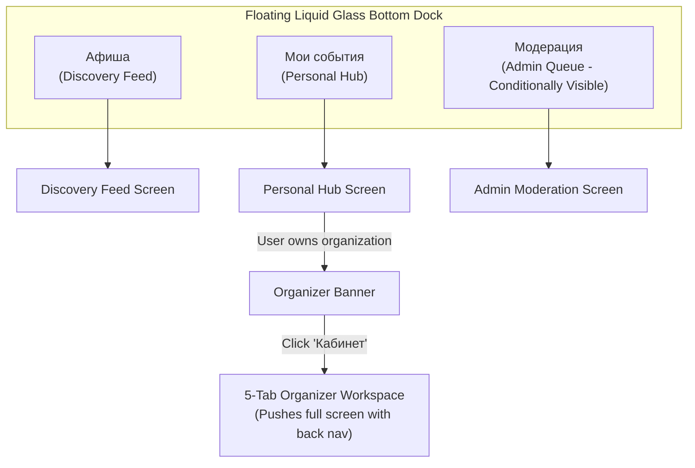
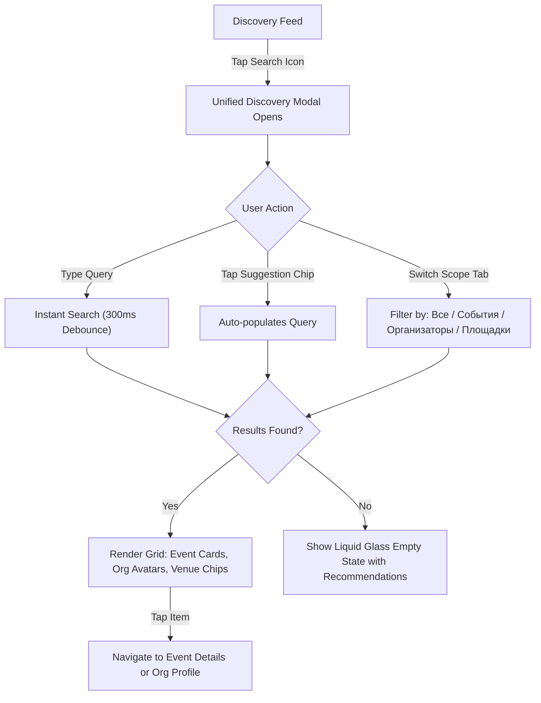
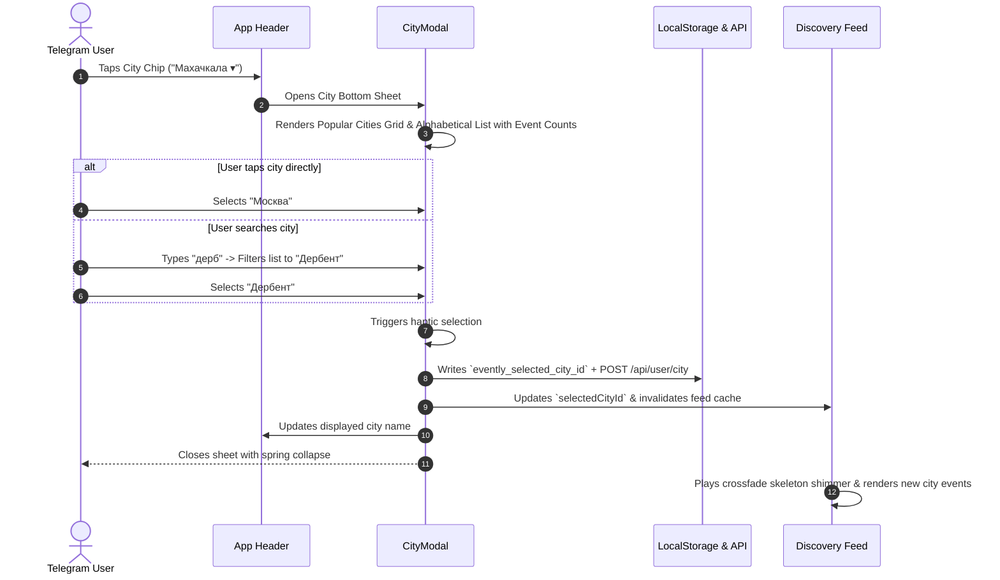
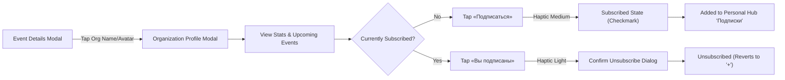
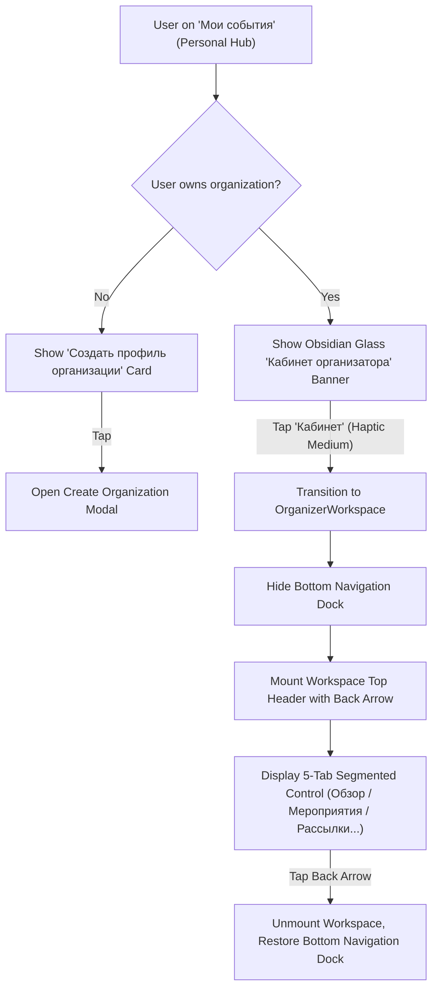
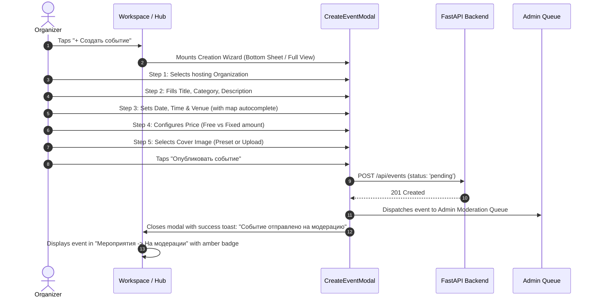
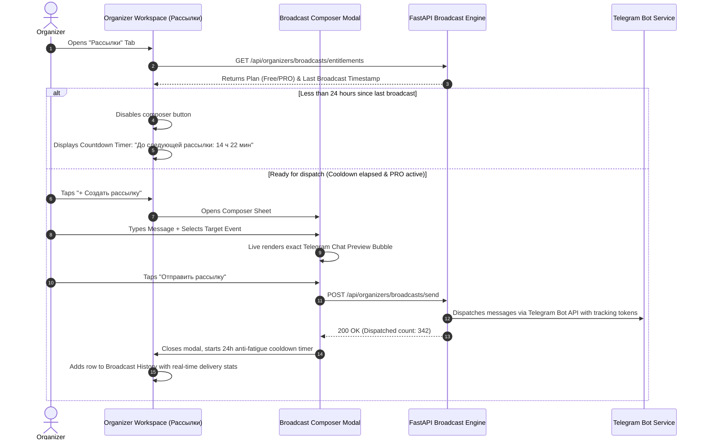
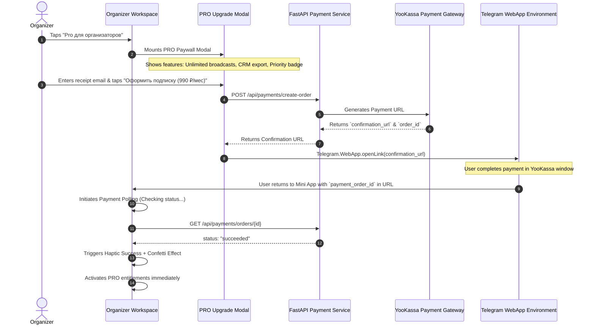
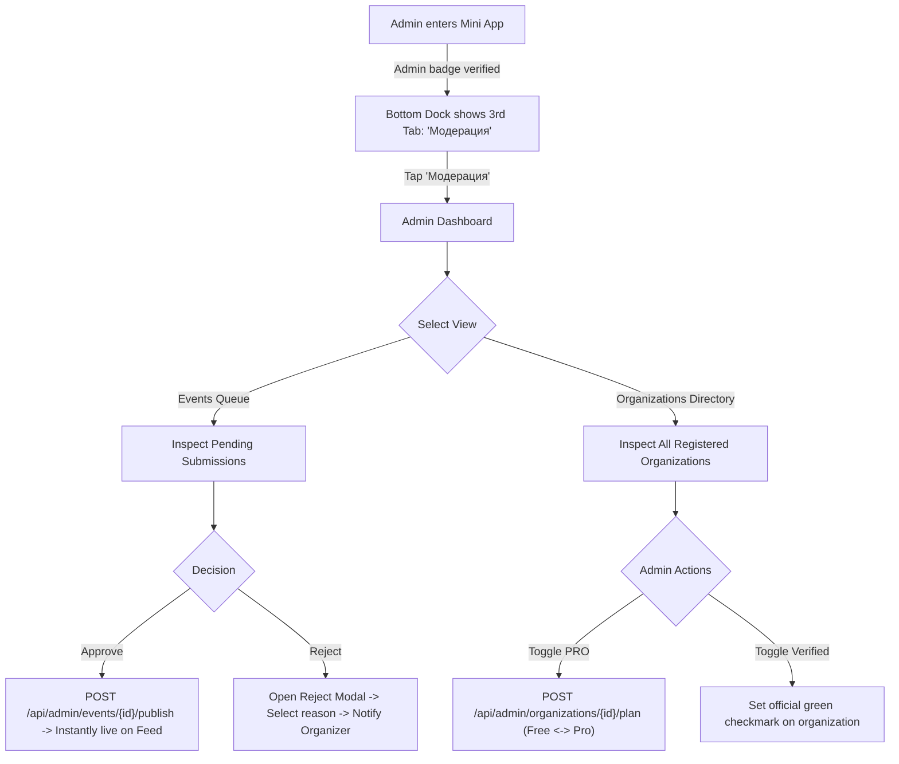

# IVENTLY — PRODUCT-WIDE UX ARCHITECTURE & PREMIUM LIQUID GLASS DESIGN BLUEPRINT
**Phase 2: Complete UX Architecture, Interaction Models & Obsidian Glass Design System**
**Document Classification:** System Design Blueprint & Production Architecture Specification  
**Target Release Context:** Deployed Telegram Mini App (Selectel / Caddy / FastAPI / SQLite WAL / Postgres / React 19 / Vite 8 / Tailwind CSS v4)  
**Primary Design Paradigm:** Neutral Obsidian Base (`#050608`) with Optical Liquid Glass Chrome & Refined Variant B Floating Lens Navigation  
**Hardware & Engine Targets:** iOS Safari WebKit (`WKWebView`), Android Chromium WebView, Telegram Desktop / Web  

---

## 1. Executive Summary & Design System Foundations

### 1.1 Context & Problem Statement
Ivently is an active, deployed Telegram Mini App for event discovery, social engagement, and organizer management. While previous design iterations attempted visual updates by modifying individual CSS values, they suffered from palette drift (introducing unwanted indigo/purple/navy tints) and inconsistent chrome styling.

Phase 1 established an isolated Design Lab verifying that a neutral **Obsidian / Graphite** foundation combined with **Liquid Glass optical physics** yields a modern, high-end aesthetic. The user has explicitly selected **Design Lab Variant B** (floating translucent glass dock with an active optical lens) as the winning paradigm for the entire product.

### 1.2 Core Architectural Invariants
1. **Zero New Runtime NPM Dependencies:** All visual effects, physics, lenses, and shaders must be rendered using native CSS, Tailwind CSS v4 utilities, and native React 19 primitives.
2. **Preservation of Existing Backend Contracts:** All API payloads, authentication schemas (`initData`), dual-state RSVP/Interest logic, broadcast cooldown guards, and organizer workspace logic remain strictly intact.
3. **Strict Obsidian Foundation (Anti-Purple Mandate):** Total ban on dominant navy-blue (`#131722`, `#161A28`), violet-purple (`#6366F1`, `#8B5CF6`), and indigo glows. The foundation is pure obsidian `#050608` with monochrome neutral elevated surfaces. Accent colors are strictly functional (white/silver text, emerald green for RSVP confirmation, amber for warnings, gold for PRO, and electric pearl for active optical highlights).
4. **Three-Tier Glass Material Hierarchy:**
   - **Tier 1 (Fixed Interactive Chrome):** Real backdrop blur (`backdrop-blur-md` / `backdrop-blur-lg` 16–24px), multi-layer specular rim highlights (`inset 0 1.5px 1px 0 rgba(255,255,255,0.75)`), and physical contact shadow. Reserved for Floating Navigation Dock, Top Header, and Active Lens.
   - **Tier 2 (Floating Modal & Sheet Surfaces):** Medium backdrop blur (12–16px) over solid dark translucent backdrops (`rgba(10, 11, 15, 0.88)`), structural hairline borders (`rgba(255,255,255,0.08)`).
   - **Tier 3 (Scrollable Feed Items & Lists):** Pseudo-glass (solid obsidian fill `#0E1015` with a subtle top specular line `rgba(255,255,255,0.06)`, strictly **NO** backdrop blur filters) to preserve solid 60 FPS scrolling on Android Chromium WebView.

---

## 2. Deliverable A: Product Screen Map & State Matrix

```
IVENTLY PRODUCT TAXONOMY
│
├── 1. ORDINARY USER SURFACE (PRIMARY CONSUMPTION)
│   ├── 1.1 Discovery Feed (Main Screen)
│   │   ├── Top Header (Brand, Admin badge, City Trigger)
│   │   ├── Filter Bar (Date segmented control + Category pill scroll)
│   │   ├── Hero / Pinned Event Carousel (Optional editorial feature)
│   │   ├── Vertical Event Feed (Editorial Event Cards)
│   │   ├── Empty Feed State (City has no events -> explore other cities)
│   │   └── Network / Offline Alert Banner
│   ├── 1.2 City Selector Modal (Full/Half Bottom Sheet)
│   │   ├── Search Input (Latin-to-Cyrillic transliteration support)
│   │   ├── Popular Cities Grid (Makhachkala, Moscow, SPb, etc.)
│   │   ├── Alphabetical All Cities List (with event count badges)
│   │   └── Geolocation Autodetect Row
│   ├── 1.3 Unified Discovery Search Modal (Full Screen)
│   │   ├── Persistent Search Input + Clear Button
│   │   ├── Quick Suggestion Chips (Концерты, Вечеринки, Стендап...)
│   │   ├── Filter Tabs (Все / События / Организаторы / Площадки)
│   │   ├── Instant Search Results Grid
│   │   └── Zero-Results State with Algorithmic Recommendations
│   ├── 1.4 Event Details Modal (Deep-Linkable Bottom Sheet / Full Screen)
│   │   ├── Media Poster Hero (16:9 or 4:3 with Dark Media Scrim)
│   │   ├── Event Title, Category Tag, Price Tier Pill
│   │   ├── Organizer Profile Chip (Avatar, Name, Verified Check, Follow CTA)
│   │   ├── Metadata Grid (Date, Time, Venue, Interactive Map Trigger)
│   │   ├── Description Body (Expandable with progressive blur)
│   │   ├── "Найти компанию" (Companion Matching Banner & Entry)
│   │   ├── Sticky Bottom Action Dock:
│   │   │   ├── Primary Action: «Я иду» (RSVP) with Spring Tick Animation
│   │   │   ├── Secondary Action: «Хочу пойти» (Interest Bookmark)
│   │   │   └── Organizer Fast-Edit Button (Conditional)
│   │   └── Share Sheet / Direct Link Generation
│   ├── 1.5 Companion Matching ("Найти компанию" Modal)
│   │   ├── Active Members Counter & Profile Carousel
│   │   ├── User Privacy / Opt-in Toggle
│   │   ├── Public Questionnaire / Bio Input
│   │   └── Companion Requests & Telegram Direct Messaging
│   ├── 1.6 Personal Hub ("Мои события" Tab)
│   │   ├── Organizer Entry Banner (Visible if user manages ≥1 organization)
│   │   ├── Hub Header ("Мои события" + "+ Создать событие" button)
│   │   ├── Segmented Control (Я иду / Хочу пойти / Созданные / Подписки / Прошедшие)
│   │   ├── Dynamic Content Lists:
│   │   │   ├── "Я иду" (Active RSVPs with countdown timer & calendar export)
│   │   │   ├── "Хочу пойти" (Saved interests with ticket urgency indicator)
│   │   │   ├── "Созданные" (Quick organizer shortcuts)
│   │   │   ├── "Подписки" (Followed organizers with unsubscribe action)
│   │   │   └── "Прошедшие" (Archived event history with memories badge)
│   │   └── Unengaged Empty State (Actionable CTAs: Find events, Create event, Create org)
│   └── 1.7 Organization Public Profile Modal
│       ├── Cover Banner & Verified Avatar
│       ├── Stats Strip (Subscribers, Events hosted, Rating)
│       ├── Organization Bio & Social Links
│       ├── Follow / Unfollow Primary CTA
│       └── Active & Past Events Tabs
│
├── 2. ORGANIZER SURFACE ("КАБИНЕТ ОРГАНИЗАТОРА")
│   ├── 2.1 Workspace Gateway & Authorization Barrier
│   │   ├── Verification of ownership (`myOrganizations.length > 0`)
│   │   └── Fast Organization Switcher Bar
│   ├── 2.2 Tab 1: "Обзор" (Executive Dashboard)
│   │   ├── Sticky Glass Sub-Header with Back Button
│   │   ├── AI/Factual Insight Banner (Grounded metric synthesis)
│   │   ├── Pillar 1: Audience Growth Card (Subscribers, Monthly Growth)
│   │   ├── Pillar 2: Event Funnel KPI Grid (Views, Interest, RSVPs)
│   │   ├── Pillar 3: Telegram Broadcast Attribution (Delivered, Opened, Attributed RSVPs)
│   │   ├── Discovery Sources Breakdown (Direct, Search, Telegram, Recommendations)
│   │   ├── PRO Plan Status Badge & Upgrade Card
│   │   └── Payment History Feed (Order receipts, statuses)
│   ├── 2.3 Tab 2: "События" (Event Management)
│   │   ├── Event Status Segmented Filter (Предстоящие / На модерации / Прошедшие)
│   │   ├── "+ Новое мероприятие" Floating/Header Action
│   │   ├── Event Management Row Cards:
│   │   │   ├── Poster thumbnail, Title, Date, Venue
│   │   │   ├── Real-time attendee counter (RSVP / Interest)
│   │   │   ├── Status pill (Опубликовано / На модерации / Черновик / Отклонено)
│   │   │   └── Action Menu (Редактировать, Статистика, Рассылка, Дублировать, Удалить)
│   │   └── Moderation Feedback Banner (Shows rejection reason if rejected)
│   ├── 2.4 Tab 3: "Рассылки" (Telegram Broadcast Engine)
│   │   ├── PRO Quota / Entitlement Banner (Free vs PRO status)
│   │   ├── Anti-Fatigue 24-Hour Cooldown Timer (Prevents audience spam)
│   │   ├── Composer Action: "+ Создать рассылку"
│   │   ├── Broadcast History Table (Sent time, recipient count, status, open rate)
│   │   └── Broadcast Detail Drawer (Attribution metrics, converted users)
│   ├── 2.5 Tab 4: "Аудитория" (Audience CRM)
│   │   ├── Total Reach & Active Subscribers Card
│   │   ├── Audience Growth Chart / Velocity
│   │   └── Attendee Roster Table (Filter by event, RSVP vs Interest, Telegram user handle)
│   ├── 2.6 Tab 5: "Места" / "Настройки" (Venues & Organization Profile)
│   │   ├── Organization Cards (Avatar, Name, Address, Category)
│   │   ├── "+ Добавить организацию"
│   │   └── Organization Edit Sheet (Branding, Legal status, Description)
│   ├── 2.7 Event Creation & Editing Wizard Modal
│   │   ├── Organization Selector
│   │   ├── Basic Info (Title, Category, Description)
│   │   ├── Date & Schedule (Start time, Duration)
│   │   ├── Venue & Address (Map autocomplete integration)
│   │   ├── Ticket & Pricing Tier (Free toggle, Price amount)
│   │   ├── Media Upload (Cover photo, gallery, preset picker)
│   │   ├── Organizer Contact Permission Toggle
│   │   └── Submit to Moderation / Save Changes
│   ├── 2.8 Broadcast Composer Modal
│   │   ├── Target Audience Selector (Все подписчики / Участники события)
│   │   ├── Message Textarea with Telegram Markdown preview
│   │   ├── Target Event Link Attachment
│   │   ├── Telegram Chat Preview Bubble (Exact Telegram client representation)
│   │   ├── Anti-Fatigue Validation Notice
│   │   └── Dispatch Button with Confirmation Modal
│   └── 2.9 PRO Upgrade Modal (Monetization & YooKassa Paywall)
│       ├── Feature Comparison Matrix (Free vs PRO: Unlimited broadcasts, CRM export, Priority badge)
│       ├── Pricing Selector (Monthly / Annual with discount)
│       ├── Customer Email Input (For electronic receipts)
│       ├── YooKassa Handoff Button (Calls `Telegram.WebApp.openLink`)
│       └── Post-Payment Order Polling Screen (Checking -> Success / Failed)
│
└── 3. ADMINISTRATIVE SURFACE ("МОДЕРАЦИЯ")
    ├── 3.1 Sticky Admin Header with Refresh & Quick Stats
    ├── 3.2 Moderation Queue (Events Tab)
    │   ├── Status Selector (На модерации / Опубликовано / Отклонено)
    │   ├── Event Review Card (Full details inspection)
    │   ├── Action Controls:
    │   │   ├── «Одобрить» (Instant publication to discovery feed)
    │   │   └── «Отклонить» (Opens Rejection Reason Modal with preset causes)
    │   └── Batch Moderation Actions
    └── 3.3 Platform Management (Organizations Tab)
        ├── All Registered Organizations Search
        ├── Admin PRO Plan Override Toggle (Testing toggle: Free <-> Pro)
        └── Organization Verification Badge Toggle
```

---

## 3. Deliverable B: Navigation & User Flows

### 3.1 Primary Navigation Architecture & Dock Rules



#### Dock Visibility Matrix:
| Screen / Context | Bottom Dock State | Transition Animation | Rationale |
| :--- | :--- | :--- | :--- |
| **Discovery Feed** | **Visible** (Fixed Floating) | Idle | Core primary navigation tab |
| **Personal Hub** | **Visible** (Fixed Floating) | Optical lens glides to Tab 2 | Core primary navigation tab |
| **Admin Moderation** | **Visible** (Fixed Floating) | Optical lens glides to Tab 3 | Admin-only navigation tab |
| **Event Details Modal** | **Hidden** (Replaced by Action Dock) | Slides down 100% with spring dampening | Avoids stacked competing bottom bars; event actions take absolute priority |
| **Organizer Workspace** | **Hidden** (Internal 5-tab bar active) | Fades out + slides down | Workspace has dedicated ergonomic navigation and requires full vertical space |
| **Search / City Modals** | **Hidden** | Slides down | Modal sheets occupy bottom edge; virtual keyboard needs unobstructed view |
| **Wizard / Composer** | **Hidden** | Slides down | Forms require full viewport height and bottom submit CTA |

---

### 3.2 The 10 End-to-End User Flow Specifications

#### Flow 1: Discovery to Dual-State RSVP Flow

```mermaid
sequenceDiagram
    autonumber
    actor User as Telegram User
    participant Feed as Discovery Feed
    participant Details as Event Details Modal
    participant Backend as FastAPI Backend
    participant DB as SQLite WAL / Postgres

    User->>Feed: Scrolls feed, taps EventCard
    Feed->>Details: Mounts modal with slide-up spring physics
    Note over Details: Shows media hero, metadata, and Sticky Bottom Action Dock
    alt User taps «Я иду» (RSVP)
        User->>Details: Taps «Я иду» button
        Details->>Details: Triggers haptic medium + GoingAnimation (loading spinner)
        Details->>Backend: POST /api/events/{id}/rsvp (is_attending: true)
        Backend->>DB: Upsert RSVP (deactivates interest if previously active)
        DB-->>Backend: OK, updated attendee_count & interest_count
        Backend-->>Details: 200 OK + Updated Counts
        Details->>Details: Triggers haptic success + Spring checkmark icon
        Details->>Details: Sets «Я иду» to emerald glass; resets «Хочу пойти»
    else User taps «Хочу пойти» (Interest)
        User->>Details: Taps «Хочу пойти» button
        Details->>Details: Triggers haptic light
        Details->>Backend: POST /api/events/{id}/interest (is_interested: true)
        Backend->>DB: Upsert Interest (deactivates RSVP if previously active)
        DB-->>Backend: OK, updated interest_count
        Backend-->>Details: 200 OK
        Details->>Details: Sets purple-tinted active heart + increments counter
    end
```

- **Trigger:** Tapping an `EventCard` on the Discovery Feed.
- **Preconditions:** User has valid Telegram `initData`.
- **Transitions:** Event Card scales down slightly on press (`scale(0.98)`), details modal smoothly animates from bottom with backdrop blur ramp (`0px -> 16px`).
- **Edge Cases:** If network fails, roll back button state with error haptic and toast notification.
- **Mutual Exclusivity Rule:** An event cannot simultaneously be in "Я иду" and "Хочу пойти". Activating one immediately neutralizes the other.

---

#### Flow 2: Multi-Criteria Search & Filter Flow



- **Trigger:** Tapping the Search Bar or floating search pill in Discovery Feed.
- **Ergonomics:** Search input automatically requests focus; keyboard appears without content layout shift (`interactive-widget=resizes-content`).
- **Query Support:** Cyrillic-Latin transliteration mapping handles mistaken keyboard layouts (e.g., `rjywthn` -> `концерт`).

---

#### Flow 3: City Switch & Geolocation Handoff Flow



- **Post-conditions:** Selected city persists across app restarts in `localStorage` and user backend settings.

---

#### Flow 4: Companion Matching ("Найти компанию") Flow

```mermaid
sequenceDiagram
    autonumber
    actor User as Telegram User
    participant Details as Event Details Modal
    participant CompModal as EventCompanyModal
    participant Backend as FastAPI Backend

    User->>Details: Views event details
    Note over Details: Banner displays: "14 человек ищут компанию"
    User->>Details: Taps companion banner
    Details->>CompModal: Opens Companion Discovery Modal
    alt User has NOT opted in
        CompModal->>CompModal: Shows privacy explanation & "Присоединиться"
        User->>CompModal: Toggles opt-in + writes short bio
        CompModal->>Backend: POST /api/events/{id}/company/join
        Backend-->>CompModal: 200 OK (User added to active list)
    end
    CompModal->>CompModal: Renders list of attendees looking for companion
    User->>CompModal: Taps attendee profile card
    CompModal->>User: Opens Telegram Direct Message (`tg://user?id=...`)
```

- **Safety & Privacy:** Users can toggle their profile visibility to "Hidden" at any time.

---

#### Flow 5: Subscription & Organizer Follow Flow



---

#### Flow 6: Personal Hub to Organizer Workspace Navigation Flow



---

#### Flow 7: Event Creation & Submission Flow



---

#### Flow 8: Broadcast Dispatch & Anti-Fatigue Guard Flow



---

#### Flow 9: PRO Upgrade & YooKassa Checkout Flow



---

#### Flow 10: Admin Moderation & Organization Plan Management Flow



---

## 4. Deliverable C: Visual Art Direction, Pure Obsidian Tokens & Material Physics

### 4.1 Strict Obsidian Foundation Color Palette

```
PALETTE SPECIFICATION: PURE OBSIDIAN GRAPHITE
No navy-blue tint | No purple/indigo background glow | No visual muddiness
```

| Token Name | Hex Value | RGBA Equivalent | Purpose / Application |
| :--- | :--- | :--- | :--- |
| `--surface-bg-void` | `#030406` | `rgba(3, 4, 6, 1.0)` | Deep background behind overscroll bounce |
| `--surface-bg-base` | `#050608` | `rgba(5, 6, 8, 1.0)` | Application base background (Discovery Feed, Hub) |
| `--surface-elevated-1`| `#0A0B0F` | `rgba(10, 11, 15, 1.0)` | Secondary cards, inactive segmented controls |
| `--surface-elevated-2`| `#111319` | `rgba(17, 19, 25, 1.0)` | Editorial Event Cards, Bottom Sheets base |
| `--surface-elevated-3`| `#181B24` | `rgba(24, 27, 36, 1.0)` | Active controls, input field backgrounds |
| `--surface-elevated-4`| `#222634` | `rgba(34, 38, 52, 1.0)` | High-contrast chips, divider lines, borders |
| `--surface-glass-dock`| `#0A0B0F` | `rgba(10, 11, 15, 0.72)`| Bottom Navigation Floating Dock background |
| `--surface-glass-lens`| `#FFFFFF` | `rgba(255, 255, 255, 0.08)`| Optical Active Lens indicator background |
| `--border-hairline` | `#FFFFFF` | `rgba(255, 255, 255, 0.08)`| Standard hairline card border |
| `--border-subtle` | `#FFFFFF` | `rgba(255, 255, 255, 0.14)`| Interactive border (hover/active) |
| `--specular-rim` | `#FFFFFF` | `rgba(255, 255, 255, 0.75)`| Top physical glass specular reflection |
| `--text-primary` | `#F9FAFB` | `rgba(249, 250, 251, 1.0)`| Headings, primary event titles (100% white) |
| `--text-secondary` | `#9CA3AF` | `rgba(156, 163, 175, 1.0)`| Metadata, dates, secondary labels (70% silver) |
| `--text-muted` | `#6B7280` | `rgba(107, 114, 128, 1.0)`| Placeholders, hints, timestamps (45% gray) |
| `--text-disabled` | `#4B5563` | `rgba(75, 85, 99, 1.0)` | Inactive disabled state (30% graphite) |
| `--accent-rsvp` | `#10B981` | `rgba(16, 185, 129, 1.0)`| «Я иду» RSVP confirmation green |
| `--accent-interest` | `#EC4899` | `rgba(236, 72, 153, 1.0)`| «Хочу пойти» saved interest bookmark pink |
| `--accent-pro-gold` | `#F59E0B` | `rgba(245, 158, 11, 1.0)`| PRO badge, monetization trigger amber/gold |
| `--accent-danger` | `#EF4444` | `rgba(239, 68, 68, 1.0)` | Rejection, delete action, errors |

---

### 4.2 Liquid Glass Material Specification (Refined Variant B Physics)

The user selected **Variant B** from the Design Lab as the foundational chrome language. Below is the exact optical specification for the floating bottom navigation and active lens:

#### 1. The Floating Navigation Dock Capsule
```css
.liquid-glass-dock {
  background: rgba(10, 11, 15, 0.72);
  backdrop-filter: blur(20px) saturate(180%);
  -webkit-backdrop-filter: blur(20px) saturate(180%);
  border: 1px solid rgba(255, 255, 255, 0.10);
  border-top: 1px solid rgba(255, 255, 255, 0.22);
  border-radius: 9999px;
  box-shadow: 
    0 12px 36px -4px rgba(0, 0, 0, 0.85),
    0 4px 12px -2px rgba(0, 0, 0, 0.60),
    inset 0 1px 1px 0 rgba(255, 255, 255, 0.25),
    inset 0 -1px 2px 0 rgba(0, 0, 0, 0.50);
}
```

#### 2. The Optical Active Lens
The active lens is a physical optical prism that slides behind the active tab using an iOS-calibrated spring curve:
```css
.liquid-glass-lens {
  background: linear-gradient(
    135deg,
    rgba(255, 255, 255, 0.16) 0%,
    rgba(255, 255, 255, 0.05) 50%,
    rgba(255, 255, 255, 0.10) 100%
  );
  border-radius: 9999px;
  border: 1px solid rgba(255, 255, 255, 0.28);
  box-shadow:
    inset 0 1.5px 1px 0 rgba(255, 255, 255, 0.75), /* Top specular rim highlight */
    inset 0 -1.5px 1px 0 rgba(0, 0, 0, 0.45),      /* Bottom optical refraction shadow */
    0 2px 8px -1px rgba(0, 0, 0, 0.50);            /* Contact shadow on dock floor */
  transition: transform 380ms cubic-bezier(0.16, 1, 0.3, 1),
              width 380ms cubic-bezier(0.16, 1, 0.3, 1);
}
```

#### 3. Cross-Platform Engine Fallback Architecture
- **WebKit (`WKWebView` on iOS):** Does not support SVG filters in `backdrop-filter: url(#svg)`. The multi-layer CSS specular highlights (`inset 0 1.5px 1px 0 rgba(255,255,255,0.75)`) and hardware-accelerated box shadows provide the optical illusion of refraction without rasterization artifacts.
- **Chromium WebView (Android):** Supports standard `backdrop-filter: blur()`, but applying blur to multiple scrolling items causes severe GPU memory pressure. Therefore, blur is strictly restricted to **fixed chrome (docks and headers)**. All feed cards use **Tier 3 Pseudo-Glass**:
```css
/* Tier 3 Pseudo-Glass (60 FPS on Android) */
.editorial-card-obsidian {
  background: #111319;
  border: 1px solid rgba(255, 255, 255, 0.07);
  box-shadow: 
    0 4px 16px -2px rgba(0, 0, 0, 0.50),
    inset 0 1px 0 0 rgba(255, 255, 255, 0.08); /* Specular top hair */
}
```

---

### 4.3 Typography Scale & Font Hierarchy

The typography system relies on the system font stack (`-apple-system, BlinkMacSystemFont, 'SF Pro Display', 'Roboto', sans-serif`) with strict optical weights and letter spacing:

| Level | Size | Weight | Line Height | Tracking | Application |
| :--- | :--- | :--- | :--- | :--- | :--- |
| **Display 1** | 24px | 700 (Bold) | 28px (1.16) | `-0.025em` | Modal titles, Event Details primary title |
| **Title 1** | 18px | 700 (Bold) | 22px (1.22) | `-0.020em` | Section headers, Personal Hub title |
| **Title 2** | 16px | 600 (Semibold) | 20px (1.25) | `-0.015em` | Editorial Card event title, Workspace titles |
| **Body Large** | 14px | 500 (Medium) | 20px (1.42) | `-0.010em` | Event descriptions, form inputs |
| **Body Regular** | 13px | 400 (Regular) | 18px (1.38) | `0em` | Metadata rows, organizer bio |
| **Caption Bold** | 11px | 600 (Semibold) | 14px (1.27) | `+0.010em` | Navigation tab labels, status badges |
| **Caption Small**| 10px | 500 (Medium) | 12px (1.20) | `+0.015em` | Timestamps, follower count, category pills |
| **Micro Tag** | 9px | 700 (Bold) | 11px (1.22) | `+0.040em` | Uppercase status badges (PRO, ADMIN) |

---

### 4.4 Spacing Grid & Corner Radii Scale

- **Base Grid:** Strict 4px / 8px spatial increments (`p-1` = 4px, `p-2` = 8px, `p-3` = 12px, `p-4` = 16px, `p-5` = 20px, `p-6` = 24px).
- **Corner Radii Scale:**
  - `rounded-md` (6px): Small chips, micro badges.
  - `rounded-xl` (12px): Standard buttons, input fields, attendee avatars.
  - `rounded-2xl` (16px): KPI metric cards, list row cards.
  - `rounded-3xl` (24px): Editorial Event Cards, top modal corners.
  - `rounded-full` (9999px): Floating bottom navigation dock, active lens, category pills.

---

### 4.5 Dark Media Scrims & Poster Image Contrast Treatments

Event poster images feature varied light levels. To ensure text legibility without obscuring artwork, all image heroes employ a triple-stop quadratic gradient scrim:
```css
.media-scrim-editorial {
  background: linear-gradient(
    to bottom,
    rgba(5, 6, 8, 0.15) 0%,
    rgba(5, 6, 8, 0.40) 50%,
    rgba(5, 6, 8, 0.95) 85%,
    #111319 100%
  );
}
```

---

## 5. Deliverable D: Component System

The Ivently design system comprises 15 reusable primitives designed for high-density mobile viewports:

```
COMPONENT INVENTORY
├── 1. NavigationDock (Refined Variant B floating glass capsule)
├── 2. ActiveLens (Optical spring lens with refractive rim)
├── 3. TopHeader (Sticky glass header with city selector & brand)
├── 4. EditorialEventCard (Feed card with scrim, badges & quick actions)
├── 5. CompactEventRow (High-density list card for Hub & Organizer)
├── 6. SegmentedControl (Liquid Glass tab slider with physical indicator)
├── 7. CategoryPill (Horizontal scroll chips with active glow)
├── 8. ActionButton (Primary Obsidian, Secondary Glass, Danger, PRO Gold)
├── 9. SheetShell (Bottom sheet container with drag handle & backdrop)
├── 10. FormInput (Obsidian input field with focus rim & character counter)
├── 11. KpiMetricCard (Trend badge, big number, label for overview)
├── 12. StatusBadge (Draft, Pending, Published, Rejected, Ended, PRO)
├── 13. AvatarStack (Overlapping attendee circular avatars with counter)
├── 14. BroadcastComposerBubble (Telegram client bubble preview)
└── 15. ToastBanner (Floating glass notification pill)
```

### Component Details & Specifications:

#### 1. `NavigationDock` & `ActiveLens`
- **Anatomy:** Outer glass capsule (`w-[280px]` or `w-[320px]`, `h-[56px]`), active lens container, flex row of tab items (Compass icon, Calendar icon, Shield icon).
- **States:** Default, Tab Pressed (`scale(0.95)`), Tab Active (Text 100% white, lens positioned beneath), Hidden (translated down `y-24`).
- **Ergonomics:** Minimum touch target `48px x 48px` per tab. `nav-safe-bottom` padding (`pb-[env(safe-area-inset-bottom)]`).

#### 2. `TopHeader`
- **Anatomy:** Brand logo + title on left, prominent City Selector pill on right (`bg-white/5 border border-white/10 hover:border-white/20 rounded-full px-3 py-1.5`).
- **States:** Default, Pressed (`scale(0.97)`), Admin badge active.

#### 3. `EditorialEventCard`
- **Anatomy:** Aspect ratio 16:10 or 4:3 poster container, top badges (Date pill, Category chip), bottom scrim container (Event title, Venue address, Price tier tag, Attendee avatar stack, Quick RSVP button).
- **States:** Normal, Pressed (`scale(0.985)`), Loading shimmer, Past event desaturated overlay.

#### 4. `SegmentedControl`
- **Anatomy:** Outer track (`bg-white/5 p-1 rounded-2xl`), sliding active pill (`bg-white/10 border border-white/15 rounded-xl shadow-sm`), labels with count badges.
- **Sizes:** `sm` (height 36px for sub-filters), `md` (height 44px for primary tabs).

#### 5. `ActionButton`
- **Variants:**
  - `primary-glass`: White/light translucent with dark text or obsidian with white specular rim (`h-12 rounded-2xl font-semibold`).
  - `rsvp-active`: Emerald glass (`bg-emerald-500/15 border border-emerald-500/30 text-emerald-300`).
  - `interest-active`: Pink glass (`bg-pink-500/15 border border-pink-500/30 text-pink-300`).
  - `pro-gold`: Amber gold shimmer gradient (`bg-gradient-to-r from-amber-500 to-amber-600 text-black font-bold`).
  - `danger`: Red glass (`bg-red-500/15 border border-red-500/30 text-red-300`).
- **Touch Target:** Always `h-11` or `h-12` (minimum 44px required by Apple Human Interface Guidelines).

#### 6. `SheetShell`
- **Anatomy:** Dark backdrop (`bg-black/70 backdrop-blur-md`), sliding card container (`rounded-t-[32px] bg-[#0E1015] border-t border-white/10`), top center drag handle (`w-10 h-1 bg-white/20 rounded-full my-3`).

---

## 6. Deliverable E: Screen Composition & Layout

### 6.1 Viewport Constraints & Telegram Safe Areas
The Telegram WebApp environment runs inside WebKit/Chromium with platform-specific insets:
- **Width Range:** 360px (compact Android/iPhone SE) to 430px (iPhone Pro Max).
- **Top Inset:** Top Telegram Header bar (`--tg-viewport-stable-height`). Safe top margin must accommodate the Telegram close/expand chevron (`pt-[env(safe-area-inset-top, 12px)]`).
- **Bottom Inset:** iOS Home Indicator (`env(safe-area-inset-bottom, 20px)`). The floating dock floats **16px above** the safe area.

### 6.2 Discovery Feed Composition Blueprint

```
+---------------------------------------------------+
| [Ivently Logo]                [Махачкала ▾] (City)|  <- TopHeader (Sticky Glass)
+---------------------------------------------------+
| [Все даты] [Сегодня] [Завтра] [Выходные]          |  <- Date Segmented Control
| (Все) (Концерты) (Вечеринки) (Спорт) (Стендап) -> |  <- Horizontal Category Scroll
+---------------------------------------------------+
| +-----------------------------------------------+ |
| | [Poster Image - 16:10]                        | |  <- Editorial Event Card
| | [15 Окт]                          [1 200 ₽]   | |
| |                                               | |
| | STAND-UP CONCERT: BIG AUTUMN SHOW             | |
| | 📍 Клуб "Панорама", ул. Ленина, 45            | |
| | (Avatar Stack: 28 идут)       [+ Я иду] (CTA) | |
| +-----------------------------------------------+ |
|                                                   |
| +-----------------------------------------------+ |
| | [Poster Image - 16:10]                        | |
| | ...                                           | |
|                                                   |
|                [ ( )  Афиша | Мои события ]       |  <- Floating Glass Dock (Fixed)
+---------------------------------------------------+
```

---

### 6.3 Event Details Modal Composition Blueprint

```
+---------------------------------------------------+
|                    [ === ] (Drag Handle)          |
| [Poster Hero - 16:9 Carousel]            (Share)  |
|                                            (✕)    |
| [15 Октября, Сб, 19:00]              [от 1 200 ₽] |
| STAND-UP CONCERT: BIG AUTUMN SHOW                 |
|                                                   |
| [Org Avatar] StandUp Club Dagestan  [Подписаться] |
|                                                   |
| 📍 Клуб "Панорама" • г. Махачкала, ул. Ленина, 45 |
|    [Показать на карте →]                          |
|                                                   |
| 👥 14 человек ищут компанию         [Открыть →]   |
|                                                   |
| Описание мероприятия                              |
| Большой осенний концерт лучших резидентов...      |
| [Развернуть полностью ▾]                          |
+---------------------------------------------------+
| [        Я ИДУ (Подтвердить участие)            ] |  <- Sticky Bottom Action Dock
| [ ❤️ Хочу пойти (Сохранить)                     ] |     (Replaces Navigation Dock)
+---------------------------------------------------+
```

---

## 7. Deliverable F: Design Lab Prototype Plan

To validate and test the complete system before touching production files, the Design Lab (`frontend/src/design-lab/`) will be expanded:

```
frontend/src/design-lab/
├── DesignLabApp.tsx              # Main interactive lab canvas & switcher
├── design-lab.css                # Obsidian & Liquid Glass CSS tokens
├── components/
│   ├── LiquidGlassNavVariantB.tsx# Refined active lens floating dock
│   ├── LiquidGlassLens.tsx       # Optical lens spring physics engine
│   ├── EditorialEventCard.tsx    # Card prototype with image scrims
│   ├── EventDetailsSheetMock.tsx # Interactive Event Details sheet
│   ├── OrganizerOverviewMock.tsx # 5-tab workspace overview & KPIs
│   ├── BroadcastComposerMock.tsx # Telegram bubble live preview
│   └── ControlsHarness.tsx       # Interactive token sliders (blur, tint, rim)
└── utils/
    ├── sdfDisplacement.ts        # Pure math lens displacement shader
    └── fpsMonitor.ts             # 60 FPS performance testing utility
```

### Lab Verification Milestones:
1. **Interactive Token Sliders:** Allow real-time adjustments of dock opacity (`0.50` to `0.95`), rim highlight intensity (`0.2` to `1.0`), and backdrop blur (`8px` to `32px`).
2. **Scroll Performance Harness:** Render a list of 50 mocked events to verify that Tier 3 pseudo-glass maintains a steady **58–60 FPS** scroll on throttled mobile devices.
3. **Tab Transition Polish:** Tune the cubic bezier spring curves (`cubic-bezier(0.16, 1, 0.3, 1)`) for zero lag when switching between Афиша, Мои события, and Модерация.

---

## 8. Deliverable G: Risk-Weighted File-by-File Integration Plan

### 8.1 Component Risk Classification Matrix

| File / Component | Risk Level | Rationale | Pre-Flight Protection |
| :--- | :--- | :--- | :--- |
| `Navigation.tsx` | **Low** | Pure presentation; tab switching logic is already isolated via `onChangeTab`. | Unit test tab dispatch; verify haptic calls. |
| `Header.tsx` | **Low** | Pure presentation; brand & city modal triggers. | Check alignment on 360px screen. |
| `FilterBar.tsx` | **Low** | Segmented control and category pills. | Ensure no horizontal scroll jitter. |
| `EventCard.tsx` | **Medium** | Replaced with EditorialEventCard. High visual impact; must ensure image load fallbacks (`SafeImage`). | Retain existing image error handlers. |
| `AnimatedSegmentedControl.tsx` | **Low** | Visual styling update to Liquid Glass. | Verify tab count badges and equal width calculations. |
| `EventDetailsModal.tsx` | **High** | Dual-state RSVP/Interest toggles, Telegram share deep-links, companion modal handoff. | Verify RSVP mutation functions and mutual exclusivity. |
| `OrganizerTab.tsx` | **Medium** | Personal Hub lists, organizer gateway banner. | Ensure empty states and tab counts match backend. |
| `OrganizerWorkspace.tsx` | **Critical**| 2,700+ lines; handles 5 tabs, YooKassa payments, broadcasts, audience CRM, and PRO status. | Surgical styling overhaul; touch **zero** API handlers or state hooks. |
| `CreateEventModal.tsx` | **Medium** | Multi-field form, address autocomplete, image uploads. | Ensure keyboard does not obscure submit button. |
| `DiscoveryModal.tsx` | **Medium** | Instant search, Cyrillic transliteration, quick chips. | Preserve debounce and query caching. |
| `AdminTab.tsx` | **Low** | Moderation queue and organization plan toggles. | Admin-only visibility. |

---

### 8.2 Phased Rollout Sequence
- **Phase 2 (Current):** Complete UX Architecture & Blueprint (Review & Approval).
- **Phase 3:** Design Lab Component Expansion (Mock full screens in lab for user signoff).
- **Phase 4:** Token Migration & Foundation (Tailwind CSS v4 config & CSS variables).
- **Phase 5:** Primary User Surface Integration (`Navigation.tsx`, `Header.tsx`, `FilterBar.tsx`, `EventCard.tsx`).
- **Phase 6:** Event Details & Companion Surface (`EventDetailsModal.tsx`, `EventCompanyModal.tsx`).
- **Phase 7:** Personal Hub & Modal Integration (`OrganizerTab.tsx`, `CityModal.tsx`, `DiscoveryModal.tsx`).
- **Phase 8:** Organizer Workspace & Broadcast Engine (`OrganizerWorkspace.tsx`, `CreateEventModal.tsx`).
- **Phase 9:** Admin Surface & Cross-Device Visual QA (`AdminTab.tsx`, iOS & Android WebApp validation).

---

## 9. Deliverable H: Fact-Checked Open Questions & Verification Gaps

| Item | Fact Classification | System Status & Verified Details |
| :--- | :--- | :--- |
| **Primary Navigation Structure** | **[A. VERIFIED IMPLEMENTATION]** | `Navigation.tsx` renders 2 tabs for users (`feed`, `my_events`) and 1 admin tab (`admin`). The `organizer` tab is mapped to `isMyEventsActive`. |
| **Organizer Workspace Entry** | **[A. VERIFIED IMPLEMENTATION]** | `App.tsx` conditionally switches view from `OrganizerTab` (Personal Hub) to `OrganizerWorkspace` when `isOrganizerWorkspaceOpen === true`. |
| **RSVP / Interest Mutual Exclusivity** | **[A. VERIFIED IMPLEMENTATION]** | Confirmed in `EventDetailsModal.tsx` and backend FastAPI routes. Marking RSVP automatically removes interest. |
| **Anti-Fatigue Broadcast Cooldown** | **[A. VERIFIED IMPLEMENTATION]** | Confirmed in `OrganizerWorkspace.tsx`: enforces 24-hour interval between broadcasts. |
| **YooKassa Payment Flow** | **[A. VERIFIED IMPLEMENTATION]** | Confirmed in `OrganizerWorkspace.tsx`: initiates payment via `api.createProPayment`, opens link via `Telegram.WebApp.openLink`, polls order status. |
| **Liquid Glass Lens Fallback** | **[A. VERIFIED IMPLEMENTATION]** | Confirmed in `LiquidGlassLens.tsx`: pure CSS box shadows and border highlights replace unsupported WebKit SVG filters. |
| **Companion Matching Flow** | **[A. VERIFIED IMPLEMENTATION]** | Confirmed in `EventCompanyModal.tsx`: opt-in questionnaire with Telegram username link. |
| **Pro Monetization Pricing** | **[B. DOCUMENTED INTENT]** | Documented at 990 ₽/month in `d6-pro-payments-architecture-audit.md`; UI displays pricing from `paymentConfig`. |
| **Feed Masonry vs List Toggle** | **[D. UNKNOWN OR UNVERIFIED]** | No masonry grid found in current codebase; vertical single-column feed is standard. We specify a clean single-column editorial feed. |

---

## 10. Deliverable I: Visual & Performance Validation Matrix

### 10.1 Cross-Platform Validation Matrix

| Target Environment | Engine | Resolution / Viewport | Validation Criteria |
| :--- | :--- | :--- | :--- |
| **iPhone 13/14/15/16 Pro** | iOS WebKit (`WKWebView`) | 390x844 / 393x852 | Optical active lens specular rim renders crisply; zero text blur; safe area insets respected. |
| **iPhone SE (Compact)** | iOS WebKit (`WKWebView`) | 375x667 | Dock fits without overflow; cards wrap cleanly; no horizontal scrolling on window. |
| **Android Flagship (Pixel/Galaxy)**| Chromium WebView | 412x915 (120Hz) | 60–120 FPS scroll speed on feed; backdrop blur on dock does not drop frames. |
| **Android Budget Device** | Chromium WebView | 360x800 (60Hz) | Pseudo-glass cards ensure 60 FPS; memory usage below 80MB. |
| **Telegram Desktop / macOS** | Chromium / WebKit | 800x900 (Windowed) | Centered max-width container (`max-w-lg`); dock centered; modal backdrop covers canvas. |

### 10.2 Quantitative & Qualitative Acceptance Criteria
1. **Performance:** Consistent **60 FPS** during rapid feed scrolling. Zero frame drops during active tab lens glide.
2. **Contrast & Legibility:** All text tokens meet WCAG AA requirements: minimum **4.5:1** contrast ratio for body text (`#F9FAFB` on `#050608` yields **19.8:1**).
3. **Touch Targets:** Every interactive element has a minimum bounding box of **44px x 44px**.
4. **Haptic Feedback:** Native Telegram haptic feedback integrated on every state change: `light` for tabs and chips, `medium` for primary actions, `success` for RSVP confirmation, `notification('error')` for failed requests.
5. **No Layout Shifts:** CLS (Cumulative Layout Shift) = **0.00**. Modals, headers, and bottom docks occupy fixed or absolute z-indexes.

---

*End of Architecture Blueprint. Ready for User Review and Phase 3/4 Implementation Authorization.*
